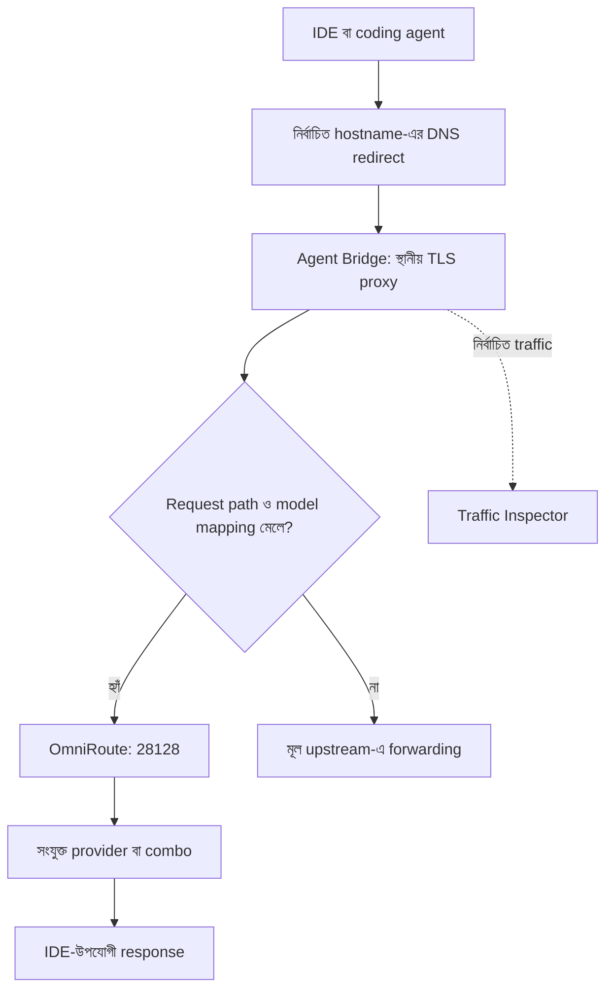

> **ঐতিহাসিক নথি — public copy, ২০২৬-১০-১৭।** মূল ঘটনার তারিখ ও ফল এই নথির নিজস্ব সময়ের জন্য প্রযোজ্য; পরের সংযোজন থাকতে পারে। বর্তমান অবস্থা ও কাজের নিয়মের জন্য [বর্তমান handoff](../CURRENT-STATUS-2026-10-17.md) পড়ুন। Private reference ও identifier সরানো হয়েছে; স্থানীয় evidence এখানে অন্তর্ভুক্ত নেই। পুরোনো cleanup, build, deploy বা service command বর্তমান অনুমতি হিসেবে ব্যবহার করবেন না।

# OmniRoute Agent Bridge: বিস্তারিত গবেষণা ও লোকাল যাচাই

পর্যবেক্ষণের সময়: ২ অক্টোবর ২০২৬, সকাল ০৬:৩৩–০৬:৩৯, বাংলাদেশ সময়। Source checkout ও ইনস্টল করা runtime: `3.8.51`। পেজ: `http://omni.local/dashboard/tools/agent-bridge`।

এই প্রতিবেদন Chrome-এ খোলা পেজ, read-only SQLite queries, process ও port পরীক্ষা, upstream GitHub-এর version-pinned documentation এবং ইনস্টল করা proxy code মিলিয়ে তৈরি। লাইভ IDE থেকে AI generation, streaming, tool execution বা failover চালানো হয়নি। কোনো provider quota খরচ করা হয়নি। Certificate trust, DNS, system proxy, service বা saved mapping বদলানো হয়নি। Model picker দেখার জন্য তৈরি করা খালি draft row সংরক্ষণ না করেই সরিয়ে দেওয়া হয়েছে।

**মূল সিদ্ধান্ত**

Agent Bridge নির্বাচিত IDE বা coding agent-এর HTTPS request স্থানীয়ভাবে ধরে OmniRoute-এর provider/model/combo-তে পাঠানোর ব্যবস্থা। আপনার Mac-এ পেজ ও catalogue কাজ করছে, কিন্তু bridge সক্রিয় নেই। `443` port Local অ্যাপের nginx দখল করে আছে। এছাড়া UI-তে ১০টি agent থাকলেও বাস্তব standalone proxy-র routing সবগুলোর জন্য সম্পূর্ণ যুক্ত নয়। তাই এখনই সব agent কাজ করবে ধরে নিয়ে এটি চালু করা ঠিক হবে না।

## ১. Agent Bridge আসলে কী করে

স্বাভাবিক অবস্থায় IDE তার নির্ধারিত AI server-এ request পাঠায়। Agent Bridge ব্যবহার করলে নির্বাচিত server hostname-এর স্থানীয় resolution বদলে request Mac-এর proxy-তে আনা হয়। IDE যাতে স্থানীয় proxy-র TLS certificate গ্রহণ করে, তার জন্য স্থানীয় CA trust প্রয়োজন হয়। Proxy request-এর model ID দেখে mapping প্রয়োগ করে, তারপর OmniRoute-এ পাঠায়।



এখানে routing এবং traffic inspection আলাদা ফল। Request দেখা যাচ্ছে মানেই request অন্য model-এ পাঠানো হয়েছে এমন নয়। বর্তমান proxy আগে traffic capture করতে পারে, পরে path ও mapping না মিললে মূল upstream-এ forward করে।

OmniRoute-এর [AgentBridge guide](https://github.com/diegosouzapw/OmniRoute/blob/v3.8.51/docs/frameworks/AGENTBRIDGE.md) এই নকশা ব্যাখ্যা করে। বাস্তব request path যাচাইয়ে [server.cjs](https://github.com/diegosouzapw/OmniRoute/blob/v3.8.51/src/mitm/server.cjs) এবং [forwardTarget.cjs](https://github.com/diegosouzapw/OmniRoute/blob/v3.8.51/src/mitm/_internal/forwardTarget.cjs) বেশি নির্ভরযোগ্য।

## ২. আপনার বর্তমান সেটআপে যা নিশ্চিতভাবে পাওয়া গেছে

| বিষয় | বর্তমান পর্যবেক্ষণ | এর অর্থ |
|---|---|---|
| OmniRoute version | `3.8.51` | Source ও installed runtime-এর version মিলে |
| Agent Bridge | `Stopped` | বর্তমানে AI traffic reroute করছে না |
| Bridge port | `443` | মূল dashboard-এর `28128` থেকে আলাদা listener |
| Connections / Intercepted | `0 / 0` | বর্তমান পেজে active connection বা routed request নেই |
| Certificate | Diagnose-এ `cert-exists=false`, `cert-trusted=false` | এই instance-এর প্রয়োজনীয় certificate তৈরি/trust হয়নি |
| Certificate directory | `~/.omniroute-local/mitm` নেই | Diagnose-এর missing-file ফলের সঙ্গে মিলে |
| Agent DNS | সব card-এ `DNS off` | Agent Bridge-এর redirect সক্রিয় নেই |
| Agent state table | `0` row | কোনো per-agent setup state সংরক্ষিত নেই |
| নতুন mapping table | `0` row | পেজে কোনো model mapping দেখায় না |
| পুরোনো Antigravity alias | `20`টি | `key_value`, namespace=`mitmAlias`-এ আলাদা alias আছে |
| Custom bypass | `0` row | নিজের bypass rule সংরক্ষিত নেই |
| Inspector custom host / session | `0 / 0` | Custom capture target ও recorded session নেই |
| সংযুক্ত provider | `claude`, `antigravity`, `agy` | DB-তে তিনটি active connection আছে; bridge ব্যবহারের প্রমাণ নয় |
| Custom combo | `0` | Auto preset catalogue-এ থাকলেও নিজের combo তৈরি নেই |
| Port conflict | Local-এর `nginx` wildcard IPv4 ও IPv6-তে `443` শুনছে | বর্তমান bridge একই port-এ bind করতে পারবে না |

Diagnose-এর পাঁচটি check-ই ব্যর্থ হয়েছে: `server-running`, `server-reachable`, `cert-exists`, `cert-trusted`, `dns-configured`। এটি বন্ধ এবং অসম্পূর্ণ setup-এর ফল। `server-reachable` check server stopped হলে TCP probe চালায় না; তাই ওই ব্যর্থ ফল দিয়ে port খালি বলা যায় না। আলাদা `lsof` পরীক্ষায় nginx পাওয়া গেছে।

`omni.local`-এর dashboard alias `/etc/hosts`-এ আছে। এটি Agent Bridge-এর provider-host redirect নয়। একই নামে dashboard খুলতে পারা এবং HTTPS interception প্রস্তুত থাকা পৃথক বিষয়।

## ৩. এটি দিয়ে আপনার কী কী কাজ করা সম্ভব

**একটি IDE-তে ব্যবহার করা model বদলানো।** IDE যে source model ID পাঠায়, সেটিকে একটি অনুমোদিত OmniRoute target-এ map করা যায়। এতে editor ও তার file-edit/terminal workflow রেখে AI backend বদলানোর সুযোগ তৈরি হয়। তবে tool-call format, response schema, context limit এবং streaming মেলানো প্রয়োজন।

**এক জায়গা থেকে provider ও fallback নিয়ন্ত্রণ।** Request সত্যিই OmniRoute-এ এলে নির্বাচিত target-এর routing policy কার্যকর হতে পারে। Single model বেছে নিলে স্বয়ংক্রিয়ভাবে নিজের নতুন fallback chain তৈরি হয় না। Combo বা উপযুক্ত auto preset প্রয়োজন। আপনার নিজস্ব combo বর্তমানে নেই।

**Request debug করা।** Agent আসলে কোন model ID পাঠাচ্ছে, কোন request ব্যর্থ হচ্ছে, কোন path ব্যবহার করছে এবং routing বদলেছে কি না বোঝার জন্য Traffic Inspector কাজে লাগে। Native UI label এবং পাঠানো ID এক নাও হতে পারে।

**Model-ভিত্তিক কাজ ভাগ করা।** নির্দিষ্ট source ID এক target-এ এবং অন্য ID আরেক target-এ পাঠানো যায়। উদাহরণ হিসেবে দ্রুত উত্তর, জটিল coding, বা reasoning-এর জন্য আলাদা target রাখা সম্ভব। এটি mapping নকশা; এই গবেষণায় এমন workflow চালু করা হয়নি।

**Usage ও খরচ পর্যবেক্ষণ।** OmniRoute-এ যাওয়া request-এর log ও provider/model তথ্য দিয়ে ব্যবহার বোঝা যায়। Inspector-এর cost estimate provider-এর final bill বা subscription allowance-এর নিশ্চয়তা নয়।

Agent Bridge নিজে file-editing agent তৈরি করে না। Editor-এর permission, terminal execution, repository access ও কাজ অনুমোদনের নিয়ম editor বা agent-এর নিজের নিয়ন্ত্রণে থাকে। Backend বদলালে ওই ক্ষমতাগুলো স্বয়ংক্রিয়ভাবে বাড়ে না।

## ৪. UI-তে থাকা ১০টি agent এবং বাস্তব সমর্থনের সীমা

নিচের hostগুলো এই version-এর registry ও live card থেকে নেওয়া। পুরোনো guide-এর কয়েকটি row ভিন্ন।

| Agent | বর্তমান target host | গবেষণায় পাওয়া সীমা |
|---|---|---|
| Antigravity IDE | `daily-cloudcode-pa.googleapis.com`, `cloudcode-pa.googleapis.com`, এবং দুইটি sandbox host | Standalone-এ আলাদা generation path ও alias namespace আছে; live generation পরীক্ষা হয়নি |
| Kiro IDE | `api.anthropic.com` | Standalone-এ `/v1/messages` যুক্ত; guide-এর AWS-host বর্ণনা বর্তমান target-এর সঙ্গে মেলে না |
| GitHub Copilot | `api.githubcopilot.com`, `copilot-proxy.githubusercontent.com` | Card ও TypeScript handler আছে; standalone chat path সঠিকভাবে যুক্ত নয় |
| GitHub Enterprise Copilot | Static host list খালি; provider-specific configuration প্রত্যাশিত | Enterprise account/config দরকার; এই Mac-এ যাচাই হয়নি |
| OpenAI Codex | `chatgpt.com` | Card/handler-এ Chat Completions path; standalone routing এবং Responses compatibility নিয়ে ঘাটতি আছে |
| Cursor IDE | `api2.cursor.sh` | নির্দিষ্ট Chat Completions handler আছে; সব Cursor protocol/feature-এর সমর্থনের প্রমাণ নয় |
| Zed | `api.zed.dev` | Target/handler আছে; standalone reroute path অসম্পূর্ণ |
| Claude Code | `api.anthropic.com` | `/v1/messages` যুক্ত, কিন্তু Kiro-র সঙ্গে host collision আছে |
| OpenCode | `opencode.ai` | Card/handler আছে; standalone reroute path অসম্পূর্ণ |
| Trae | `trae.invalid` | ইচ্ছাকৃত placeholder; `Investigating`, কার্যকর সমর্থন নয় |

Canonical registry: [targets/index.ts](https://github.com/diegosouzapw/OmniRoute/blob/v3.8.51/src/mitm/targets/index.ts)। Host ও endpoint যাচাইয়ের জন্য এই checkout-এর `src/mitm/targets/` ফাইলগুলো পড়া হয়েছে।

### সবচেয়ে গুরুত্বপূর্ণ routing ঘাটতি

আপনার installed `standaloneRouting.cjs`-এ তিনটি dedicated configuration আছে:

```text
antigravity  → :generateContent / :streamGenerateContent
kiro         → /v1/messages
claude-code  → /v1/messages
```

অন্য agent ID দিলে function Antigravity configuration ফিরিয়ে দেয়। ফলে Copilot-এর `/chat/completions`, Cursor/Zed/OpenCode-এর `/v1/chat/completions` এবং Codex/GHE-এর Responses request নির্বাচিত chat pattern-এ মেলে না। এই branch-এ proxy request reroute না করে passthrough-এ পাঠায়।

Installed helper-এর pure function চালিয়ে pattern check করা হয়েছে। Antigravity, Kiro ও Claude Code-এর সংশ্লিষ্ট path-এ `matches=true`; অন্য উল্লিখিত path-এ `matches=false` পাওয়া গেছে। এটি helper-level verification, live IDE test নয়।

অন্যদিকে `agentBridgeMappings.ts` শুধু ওই তিনটি agent-এর নতুন mapping পুরোনো `mitmAlias` namespace-এ sync করে। তাই অন্য card-এ mapping সংরক্ষণ করা গেলেও standalone reader-এর সঙ্গে সম্পূর্ণ সংযোগ হয় না।

এই ফলের ভিত্তিতে সিদ্ধান্ত: UI-তে ১০টি নাম থাকা সবগুলোর production rerouting কাজ করার নিশ্চয়তা দেয় না। এটি code থেকে নির্ণীত integration gap; সব app-এর সর্বশেষ version চালিয়ে ব্যর্থতা পুনরুৎপাদন করা হয়নি। [Standalone routing](https://github.com/diegosouzapw/OmniRoute/blob/v3.8.51/src/mitm/_internal/standaloneRouting.cjs), [mapping synchronization](https://github.com/diegosouzapw/OmniRoute/blob/v3.8.51/src/lib/db/agentBridgeMappings.ts)।

### Kiro ও Claude Code-এর shared host

দুটির host-ই `api.anthropic.com`। Standalone target loader একই host দ্বিতীয়বার দেখলে তার agent ID বদলায় না। Registry-তে Kiro আগে, তাই ওই host-এর traffic Kiro হিসেবে চিহ্নিত হওয়ার সম্ভাবনা নয়, ওই loader-এর স্বাভাবিক ফল। এতে `claude-code` mapping বানালেও reader `kiro` alias খুঁজতে পারে।

আর `/etc/hosts` process অনুযায়ী আলাদা হয় না। এই hostname redirect করলে একই Mac-এর অন্য Anthropic client-ও ওই redirect পেতে পারে। একটি card-এর toggle দিয়েই শুধু একটি app আলাদা করে ধরা যায় ধরে নেওয়া যাবে না।

## ৫. Model mapping: source, target এবং wildcard

**Source** হলো IDE request-এর আসল model ID। **Target** হলো OmniRoute catalogue-এর ID। Target-এ provider prefix থাকলে সেই prefix-সহ ID ব্যবহার করতে হবে।

শুধু ব্যাখ্যার উদাহরণ:

```text
source: gemini-pro-agent
target: agy/claude-sonnet-4-6
```

এই mapping-এর অর্থ Antigravity ওই source ID পাঠালে উপযুক্ত routing path-এ request target model-এ যাবে। আপনার account দিয়ে target সফলভাবে generation করতে পারে কি না আগে ছোট test-এ নিশ্চিত করতে হবে।

আরেকটি সম্ভাব্য নকশা:

```text
source: *
target: auto/subscription
```

Exact source match থাকলে তা আগে ব্যবহৃত হয়; অন্য source-এর জন্য `*` fallback। শুরুতে নির্দিষ্ট একটি source mapping দিয়ে পরীক্ষা করা বেশি নিয়ন্ত্রিত। সব model wildcard-এ বদলালে বিভিন্ন ধরনের request-এর আচরণ একসঙ্গে বদলে যেতে পারে।

Live picker-এ দেখা গেছে:

- `auto/coding`, `auto/fast`, `auto/cheap`, `auto/smart`;
- `auto/subscription`, `auto/thrifty`, `auto/best-free`;
- `agy/claude-sonnet-4-6` এবং কয়েকটি reasoning variant।

এগুলো selectable catalogue entry। প্রতিটির generation সফল, tool-compatible বা আপনার plan-এ বিনামূল্যে পাওয়া যায়—এই পরীক্ষা হয়নি। `auto/thrifty`-কে খরচ হবে না এমন নিশ্চয়তা হিসেবে ব্যবহার করা উচিত নয়; তার routing ladder paid target পর্যন্ত যেতে পারে। `auto/subscription`-এর eligibility ও quota যাচাইও প্রয়োজন।

### আপনার ২০টি পুরোনো alias কেন পেজে নেই

নতুন পেজ `agent_bridge_mappings` থেকে পড়ে, যেখানে row নেই। Standalone proxy আবার `key_value/mitmAlias` থেকে পড়ে, যেখানে Antigravity-এর ২০টি alias আছে। তাই পেজের খালি mapping table পুরোনো reader-এর খালি mapping বোঝায় না।

উদাহরণ হিসেবে পুরোনো dictionary-তে `gemini-pro-agent → antigravity/gemini-pro-agent` এবং কিছু পুরোনো Claude ID থেকে নতুন Antigravity Claude ID-তে alias আছে। এগুলোর provenance এই গবেষণায় নির্ধারণ করা হয়নি; manually configured ধরে নেওয়া হয়নি।

নতুন UI-তে save করলে তিনটি supported alias namespace-এর পুরো dictionary নতুন mapping দিয়ে প্রতিস্থাপিত হতে পারে। ভবিষ্যতে mapping বদলানোর আগে পুরোনো dictionary সংরক্ষণ ও migration পরিকল্পনা করা দরকার। এই গবেষণায় কোনো mapping লেখা হয়নি।

## ৬. Traffic Inspector-এর সঙ্গে সম্পর্ক

Agent Bridge request capture করে Inspector-এ পাঠাতে পারে। Inspector-এ request header/body, response বা SSE, conversation view, model ও usage metadata, latency এবং recorded session দেখা যায়। কয়েকটি feature নির্ভর করে response-এর data পাওয়া ও protocol বোঝার ওপর।

Live buffer সাধারণত memory-তে থাকে; default সর্বোচ্চ ১০০০ entry। Recording করলে session database-এ সংরক্ষিত হয় এবং HAR/JSONL export সম্ভব। Standalone ingest path body প্রায় ৬৪ KiB-তে cap করে; অতএব Inspector-এ দেখা body সব ক্ষেত্রে মূল request-এর সম্পূর্ণ copy নয়।

এই instance-এ recorded session নেই। In-memory list খালি বা recording না থাকা আগে কখনো request হয়নি তার পূর্ণ প্রমাণ নয়। তবে বর্তমানে bridge stopped এবং intercepted counter zero।

সফল routing যাচাইয়ের সময় তিনটি জিনিস মিলতে হবে: source request ID/model, OmniRoute-এ নির্বাচিত provider ও target model, এবং IDE-তে শেষ response/tool operation। Model-কে “তুমি কোন model?” জিজ্ঞেস করে backend নিশ্চিত করা যাবে না; IDE-এর system prompt পরিচয় নির্ধারণ করতে পারে। [Traffic Inspector guide](https://github.com/diegosouzapw/OmniRoute/blob/v3.8.51/docs/frameworks/TRAFFIC_INSPECTOR.md)।

## ৭. Certificate, DNS এবং bypass-এর বাস্তব অর্থ

**Certificate trust:** Proxy স্থানীয় CA দিয়ে target hostname-এর certificate তৈরি করতে পারে। OS বা app সেই CA trust করলে encrypted request-এর plaintext proxy দেখতে পায়। API key ও OAuth token Inspector/log-এ mask করার ব্যবস্থা আছে; তাই বলে proxy চলার সময় plaintext কখনোই দেখে না এমন নয়।

**Electron app:** OS Keychain-এ trust দিলেও কোনো app-এর bundled Node runtime আলাদা CA configuration চাইতে পারে। `NODE_EXTRA_CA_CERTS` এবং app পুরোপুরি বন্ধ করে সঠিক environment থেকে পুনরায় চালু করা লাগতে পারে। এর প্রয়োজন app/runtime অনুযায়ী যাচাই করতে হবে। [Certificate migration](https://github.com/diegosouzapw/OmniRoute/blob/v3.8.51/src/mitm/cert/migration.ts), [certificate installation](https://github.com/diegosouzapw/OmniRoute/blob/v3.8.51/src/mitm/cert/install.ts)।

**Bypass:** বর্তমান code default bank-pattern, government, Okta ও Auth0 pattern চেনে। Custom pattern-এর matching simple glob; UI-তে “glob or regex” লেখা থাকলেও এই standalone matcher সাধারণ regular expression parser নয়। Guide-এর Apple/iCloud/Microsoft default bypass তালিকা বর্তমান array-তে পাওয়া যায়নি।

আর “bypass মানেই কখনো TLS decrypt হয় না” দাবি mode অনুযায়ী বিচার করতে হবে। Explicit CONNECT tunnel path-এ raw TCP bypass আছে। কিন্তু DNS redirect-এর direct TLS listener-এ TLS termination-এর পর request handler চলে; ওই path-এ user bypass pattern check দেখা যায়নি। নিজে redirect করা host-এর জন্য privacy guarantee যাচাই না করে ধরে নেওয়া যাবে না। [Bypass implementation](https://github.com/diegosouzapw/OmniRoute/blob/v3.8.51/src/mitm/_internal/bypass.cjs), [direct TLS ও CONNECT handling](https://github.com/diegosouzapw/OmniRoute/blob/v3.8.51/src/mitm/server.cjs)।

Bridge management API-তে LOCAL_ONLY guard আছে। কিন্তু standalone listener-এর `server.listen(LOCAL_PORT)`-এ host pin করা নেই; start হলে wildcard binding হতে পারে। Dashboard-এর loopback binding দিয়ে bridge listener-ও শুধু loopback-এ সীমাবদ্ধ ধরে নেওয়া যাবে না। বর্তমানে এটি চালু নেই।

## ৮. পেজের বোতামগুলোর কাজ

| Control | উদ্দেশ্য | ব্যবহার করার আগে যা জানা দরকার |
|---|---|---|
| Start | Certificate material, target file এবং proxy process প্রস্তুত/চালু করা | শুধু cosmetic action নয়; privilege থাকলে trust/DNS provisioning-ও চেষ্টা করে |
| Stop | DNS teardown ও proxy process থামানো | প্রয়োজনীয় privilege না থাকলে DNS cleanup skip হতে পারে; CA স্বয়ংক্রিয়ভাবে মুছে যায় না |
| Restart | Stop করে আবার start | আবার একই startup side effect হতে পারে |
| Trust Cert | OS trust store-এ certificate যোগ করা | TLS inspection করার ক্ষমতা তৈরি হয়; certificate file আগে থাকতে হবে |
| Download Cert | Public certificate download | Private CA key export নয়; file থাকা প্রয়োজন |
| Regenerate Cert | Certificate regeneration | Legacy leaf ও root-CA code আলাদা; এই action-এর root-CA lifecycle live পরীক্ষা হয়নি |
| Upstream CA | Corporate TLS environment-এর অতিরিক্ত CA path | স্থানীয় bridge CA trust-এর বিকল্প নয় |
| Diagnose | পাঁচটি readiness check | নিরাপদ read-only পরীক্ষা; live generation test নয় |
| Repair | অবশিষ্ট hosts/trust/proxy state পরিষ্কার | System state বদলায়; এটি সাধারণ status check নয় |
| Export config | Portable rule JSON | পূর্ণ database/certificate backup নয় |
| Import config | Exported rule apply | Existing bypass ও সংশ্লিষ্ট agent mapping প্রতিস্থাপন করতে পারে |
| Start DNS | Agent host localhost-এ redirect | System-wide hostname effect; app restart প্রয়োজন হতে পারে |
| Save mappings | Source→target rule সংরক্ষণ | সমর্থিত agent-এর পুরোনো alias dictionary-ও বদলাতে পারে |
| Restore default | নির্দিষ্ট agent-এর redirect/mapping/state reset | Shared hostname হলে অন্য app-এর প্রভাব আলাদা করে যাচাই করতে হবে |

Router key missing নিয়ে পুরোনো issue থাকলেও বর্তমান server API environment-এ key না পেলে database থেকে usable key বেছে নেওয়ার fallback রাখে। তাই আপনার `.env`-এ `ROUTER_API_KEY` নেই বলে bridge নিশ্চিতভাবে শুরু হবে না, এমন সিদ্ধান্ত সঠিক নয়। [Server actions ও key selection](https://github.com/diegosouzapw/OmniRoute/blob/v3.8.51/src/app/api/tools/agent-bridge/server/route.ts)।

## ৯. আরও দুইটি নির্দিষ্ট implementation সমস্যা

**Bypass save-এর method mismatch।** Source client এবং installed compiled browser bundle `PUT /api/tools/agent-bridge/bypass` পাঠায়। Source backend এবং installed compiled route exports-এ `GET`, `POST`, `DELETE` আছে; `PUT` নেই। ফলে Save bypass list থেকে `405 Method Not Allowed` হওয়ার শক্ত code evidence আছে। Saved configuration বদলানোর request পাঠিয়ে live failure পুনরুৎপাদন করা হয়নি। [Backend route](https://github.com/diegosouzapw/OmniRoute/blob/v3.8.51/src/app/api/tools/agent-bridge/bypass/route.ts)।

**Import ও runtime alias sync।** Normal mapping save route `syncAgentBridgeMappingsToMitmAlias()` ডাকে, কিন্তু portable import `setMappings()` পর্যন্ত করে; sync helper ডাকে না। ফলে imported mapping UI table-এ গেলেও standalone reader-এর alias dictionary সঙ্গে সঙ্গে মিলবে এমন নিশ্চয়তা নেই। Installed portability ও mapping source files checkout-এর সঙ্গে hash-এ মিলে। [Portable config code](https://github.com/diegosouzapw/OmniRoute/blob/v3.8.51/src/lib/inspector/configPortability.ts)।

Export-এ user bypass, custom hosts এবং নতুন per-agent mapping থাকে। Runtime state, trust-store installation, certificate/private key, upstream CA path, DNS state এবং পুরোনো `mitmAlias` dictionary এতে নেই। আপনার বর্তমান ২০টি পুরোনো alias রক্ষার জন্য শুধু এই Export config যথেষ্ট নয়।

## ১০. Agent Bridge, CLI Code, ACP, MCP ও Cloud Agents-এর পার্থক্য

| Feature | ভূমিকা | সাধারণ ব্যবহার |
|---|---|---|
| Agent Bridge | Existing app-এর network request intercept/reroute | App-এ উপযুক্ত custom endpoint option না থাকলে |
| CLI Code / direct config | Tool-এ OmniRoute base URL ও key দেওয়া | Codex CLI, Claude Code, OpenCode-এর মতো configurable tool |
| ACP Agents | Local agent process/session management | OmniRoute থেকে agent CLI চালানো ও session পরিচালনা |
| MCP | Tool interface প্রকাশ | উপযুক্ত client দিয়ে OmniRoute-এর tool/function ব্যবহার |
| A2A | Agent protocol-এ task exchange | Protocol-aware agent integration |
| Cloud Agents | External cloud agent service ব্যবহার | আলাদা account/auth/repository configuration |
| Traffic Inspector | Captured request/response দেখা | Debugging ও traffic investigation |

Agent Bridge চালু করলেই অন্য featureগুলো configured হয়ে যায় না। এটি WhatsApp/Gmail automation, Apple Notes import বা বহু autonomous agent চালানোর ব্যবস্থা নিজে তৈরি করে না।

Direct integration-এর জন্য আপনার OpenAI-compatible gateway base `http://127.0.0.1:28128/v1`। Claude Code-এর gateway root হিসেবে `http://127.0.0.1:28128` ব্যবহার করা হয়; তার client `/v1/messages` যোগ করে। Codex configuration guide-এ Responses API wiring আছে, যা bridge card-এর পুরোনো Chat Completions path-এর সঙ্গে একই বিষয় নয়। [CLI integrations](https://github.com/diegosouzapw/OmniRoute/blob/v3.8.51/docs/guides/CLI-INTEGRATIONS.md), [Claude Code configuration](https://github.com/diegosouzapw/OmniRoute/blob/v3.8.51/docs/guides/CLAUDE-CODE-CONFIGURATION.md), [Codex CLI configuration](https://github.com/diegosouzapw/OmniRoute/blob/v3.8.51/docs/guides/CODEX-CLI-CONFIGURATION.md)।

## ১১. আপনার জন্য ব্যবহারিক অগ্রাধিকার

**Codex CLI, Claude Code ও OpenCode:** আগে tool-এর নিজস্ব endpoint/profile configuration দিয়ে OmniRoute ব্যবহার পরীক্ষা করা ভালো। এতে বর্তমানে দেখা standalone Agent Bridge routing gap, certificate ও system-wide hostname conflict এড়িয়ে কাঙ্ক্ষিত gateway ব্যবহার করা যায়। Tool-এর নির্দিষ্ট version ও model compatibility আলাদা test করতে হবে।

**Antigravity IDE:** Agent Bridge-এর সবচেয়ে স্পষ্টভাবে যুক্ত standalone পথ এটি। Existing provider connection কাজে লাগতে পারে, তবে port conflict, certificate trust, app CA handling এবং legacy/new mapping পার্থক্য আগে সমাধান করতে হবে। TypeScript handler-এ custom model/combos catalogue merge code পাওয়া গেছে, কিন্তু current standalone path `fetchAvailableModels` generation pattern হিসেবে ধরে না; তাই IDE dropdown-এ সব combo স্বয়ংক্রিয়ভাবে যোগ হবে ধরে নেওয়া যাবে না।

**Cursor, Copilot, Zed:** এই version-এর card দেখে সফল rerouting ধরে ব্যবহার শুরু করার আগে dedicated standalone routing ও actual request protocol যাচাই/সংশোধন প্রয়োজন।

**Trae:** বর্তমানে গবেষণাধীন।

## ১২. ভবিষ্যতে চালু করার জন্য যাচাইয়ের ক্রম

এই অংশ ভবিষ্যৎ কাজের পরিকল্পনা; গবেষণার সময় কোনো step activate করা হয়নি।

1. কোন app ও version-এর একটি নির্দিষ্ট workflow পরীক্ষা হবে তা নির্ধারণ করা।
2. Existing database, `/etc/hosts`, পুরোনো alias এবং trust state সংরক্ষণ করা। Portable export-এর সীমা মাথায় রাখা।
3. Local nginx-এর `443` conflict-এর নকশা সমাধান করা। শুধু bridge port বদলালে IDE এখনও default HTTPS `443`-এ যাবে; উপযুক্ত redirect/forwarding বা আলাদা IP binding দরকার। nginx বন্ধ করে বর্তমান WordPress workflow নষ্ট করা প্রয়োজন নেই।
4. লক্ষ্য agent-এর actual standalone route, alias namespace এবং response protocol যাচাই করা।
5. Certificate তৈরি এবং প্রয়োজনীয় app/OS trust সচেতনভাবে সেট করা। এই instance-এর certificate path data directory থেকে নিতে হবে; upstream default `~/.omniroute` path অন্ধভাবে ব্যবহার করা যাবে না।
6. একটি নির্দিষ্ট model mapping এবং নির্বাচিত host redirect দিয়ে শুরু করা।
7. ছোট সাধারণ chat-এ source model ও actual provider/target log মিলিয়ে দেখা।
8. Streaming, একটি harmless tool call, একটি ছোট file-edit workflow এবং error recovery পরীক্ষা করা।
9. Combo ব্যবহার করলে fallback সত্যিই কাজ করে এবং একই account/shared quota-কে স্বাধীন capacity ধরা হচ্ছে না নিশ্চিত করা।
10. Stop/reset-এর পর DNS, app connectivity এবং trust state পর্যালোচনা করা।

Router/model সফলভাবে কাজ করছে নিশ্চিত হওয়ার আগে বহু app বা wildcard mapping একসঙ্গে চালু করলে ব্যর্থতার কারণ খুঁজে পাওয়া কঠিন হবে।

## ১৩. গবেষণার প্রমাণ ও সীমা

**সরাসরি দেখা:** Live page, five-check Diagnose, ১০টি card, model picker, missing certificate directory, DB row counts, পুরোনো ২০টি alias, service data path এবং Local nginx listener।

**Installed code-এ পরীক্ষা:** Pure routing-pattern check এবং checkout/runtime SHA-256 comparison। `server.cjs`, `standaloneRouting.cjs`, `bypass.cjs`, `forwardTarget.cjs`, `agentBridgeMappings.ts`, `configPortability.ts`, `targets/index.ts` মিলেছে। Compiled browser bundle ও bypass route exports-ও পরীক্ষা করা হয়েছে।

**Code থেকে সিদ্ধান্ত:** অসম্পূর্ণ multi-agent wiring, shared Anthropic host classification, bypass method mismatch, import sync gap এবং direct-TLS bypass guarantee-এর সীমা।

**এখনো পরীক্ষা হয়নি:** Bridge startup, nginx-এর সঙ্গে সহাবস্থান, CA install/trust, actual IDE interception, successful upstream generation, streaming/tool correctness, quota/fallback, recorded session/export/restore, certificate regeneration বা shutdown cleanup।

Upstream documentation-এর version/date header ও কিছু host/support claim পুরোনো বা পরস্পর অসামঞ্জস্যপূর্ণ। তাই এই প্রতিবেদনে current checkout, installed runtime এবং live observation-কে সিদ্ধান্তের প্রধান ভিত্তি করা হয়েছে। এটি উল্লেখিত সময়ের snapshot; পরবর্তী update বা configuration change হলে আবার যাচাই করতে হবে।
