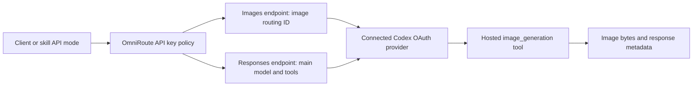

> **ঐতিহাসিক নথি — public copy, ২০২৬-১০-১৭।** মূল ঘটনার তারিখ ও ফল এই নথির নিজস্ব সময়ের জন্য প্রযোজ্য; পরের সংযোজন থাকতে পারে। বর্তমান অবস্থা ও কাজের নিয়মের জন্য [বর্তমান handoff](../CURRENT-STATUS-2026-10-17.md) পড়ুন। Private reference ও identifier সরানো হয়েছে; স্থানীয় evidence এখানে অন্তর্ভুক্ত নেই। পুরোনো cleanup, build, deploy বা service command বর্তমান অনুমতি হিসেবে ব্যবহার করবেন না।

# OmniRoute image generation: complete research, experiments ar creation references

Author: Jillur Rahman<br>
Research date: 2026-10-03, Asia/Dhaka<br>
Document type: local experiment-er consolidated report, reproducible examples ar evidence index

## 1. Confirmed outcome

**Client-er sudhu newly-created OmniRoute API key diye server-e connected Codex account use kore image generate kora geche. Dui round miliye 17-ti actual generation successful: 4-ti Images/skill generation, 12-ti requested model-combination generation ar 1-ti invalid-model control.**

GPT-5.5 ar GPT-5.6 Sol/Terra/Luna backing model diye generation hoyeche. Second round-er 13-ti response-i hosted image tool-er identity `gpt-image-2-codex` return koreche. `gpt-image-2.5-sunburst` ba `gpt-image-2.5-flare` request korleo oi specific engine select hoyeche, seta confirm hoyni.

Requested `high` quality ar exact `1024x1024` resolution-o second round-e enforce hoyni: 12-ti matrix result-e 6-ti `low`, 6-ti `medium`, 0-ti `high`; sob image `1254x1254`. Image dekhte bhalo howa, selected engine confirm howa ar requested rendering parameters honor howa alada validation.

Ei report archived real requests ar outputs-er upor based. Ei document bananor somoy notun generation, account change ba configuration mutation kora hoyni. Environment/settings-er values experiment-time snapshot; later account quota ba software state independently change hote pare.

## 2. Research questions ar scope

| Question | Verified answer |
|---|---|
| Sudhu OmniRoute client key diye connected Codex account-er image capability use kora jay? | Hae, 17 successful generations |
| Client-er OpenAI platform key ba local Codex CLI dorkar hoyeche? | Ei API-only tests-e konotai use hoyni; server-er existing Codex OAuth connection use hoyeche |
| Existing `codex-imagegen` skill OmniRoute diye use kora jay? | Existing API engine diye one successful generation; default native engine automatically replace hoy na |
| GPT-5.5 ar GPT-5.6 Sol/Terra/Luna kaj kore? | Tested backing models successful; full model/effort catalog test kora hoyni |
| Explicit GPT Image 2.5 Sunburst/Flare selection verified? | Na; returned tool identity `gpt-image-2-codex` |
| `high` quality ar exact pixel size guaranteed? | Ei tested Codex route-e honor hoyni |
| Results diye true Sunburst vs Flare quality/speed ranking kora jay? | Na; actual returned tool identity same chhilo |
| Generation free ba unlimited? | Ei test cost/quota invoice establish koreni |

17-ti successful generation-er moddhe invalid-model control ekta diagnostic generation. Eta valid requested-model benchmark-er sample noy. Extra auth/policy probes generation koreni.

## 3. Experiment-time environment

| Item | Recorded value |
|---|---|
| Dashboard/API Manager | [API Manager](http://omni.local/dashboard/api-manager) |
| Connected account page | [Codex provider](http://omni.local/dashboard/providers/codex) |
| Client base URL | `http://omni.local/v1` |
| Direct generation endpoint | `POST /v1/images/generations` |
| Image catalog | `GET /v1/images/generations` |
| Explicit hosted-tool test | `POST /v1/responses` |
| OmniRoute version | `3.8.51` |
| Source HEAD | `f77079418d844a618fd0429afe0a62c86fbcb795` |
| Runtime build receipt | `f77079418` |
| Source checkout | `~/Developer/OmniRoute`, clean at experiment verification |
| Active Codex connection | 1 |
| Active OpenAI / OpenRouter connections | 0 / 0 at the recorded second-round check |
| Round 1 live records | 2026-10-03, approximately 09:12-09:15 Asia/Dhaka |
| Round 2 execution | 2026-10-03, approximately 09:31-09:38 Asia/Dhaka |

No source/runtime fix, rebuild, service restart, Agent Bridge edit, native account change ba Codex re-login ei generation experiments-e kora hoyni. Existing provider proxy setting preserve kora hoyeche.

## 4. Main model, routing ID ar image engine

| Name/field | Role | Ekhane ki confirm hoyeche |
|---|---|---|
| `codex/gpt-5.6-sol-image` | OmniRoute Images catalog-er routing ID | Sol backing model diye image workflow initiate kore |
| `codex/gpt-5.5`, `codex/gpt-5.6-sol/terra/luna` | Responses-er provider-prefixed main model | Response-er main model protita request-er sathe match |
| `tools[].type = image_generation` | Hosted image tool | Generated image result return kore |
| `tools[].model` in request | Intended pixel-generation engine selector | 2, 2.5 Sunburst ar 2.5 Flare names pathano hoyeche |
| Returned `tools[].model` | Provider-reported tool identity | Second round-e sob khetre `gpt-image-2-codex` |

Sol/Terra/Luna name-gulo image engine-er version-er naam noy. Main model prompt process/tool orchestration korte pare; hosted image tool actual image generation kore. Main model-er `reasoning.effort = high` ar image tool-er `quality = high` alada settings.

`gpt-image-2-codex` provider-reported identity. Exact internal checkpoint ba public GPT Image 2 snapshot-er equivalence independently verify kora hoyni. Prothom Images endpoint response tool identity expose koreni; later Responses result theke prothom char-ti PNG-r exact engine retrospectively certify kora hoyni.

## 5. Routing flow



Client local gateway-te authenticate kore. OmniRoute server tar saved connected account diye upstream request pathay. Client-ke server-er OAuth token copy korte hoyni. Restored image-only key Responses endpoint-e blocked; diagram-er Responses branch sudhu temporary test permission enabled thakar somoy accessible chhilo.

## 6. Created API key ar final permissions

Browser-e user confirmation-er por `codex-imagegen-experiment-2026-10-03` name-e notun key create kora hoyechhilo. Test shesh-e final policy:

| Setting | Final saved policy |
|---|---|
| Active | On |
| Model access | Restricted |
| Allowed models | `codex/gpt-5.6-sol-image`, `codex/gpt-5.6-terra-image`, `codex/gpt-5.6-luna-image` |
| Allowed connection | Existing single Codex connection |
| Inference endpoint category | `images` |
| Management access | Off |
| Own usage scope | `self:usage` |
| Prompt compression | Off |
| Auto Combos | Off |
| Max active sessions / throttle | 0 / 0 |
| Custom key rate limits, schedule, USD quota | Experiment key-te add kora hoyni |
| Expiry | Set kora hoyni |

Exact credential value ei document ba evidence archive-e nei. Protected home file: `~/Documents/Codex/2026-10-03/omniroute-image-experiment/private/omniroute-api-key`; recorded file mode `600`, private directory mode `700`.

Created key-er masked browser proof (স্থানীয় image; প্রকাশিত নয়)

Second round-er jonno same key-te samoyik bhabe four backing GPT models ar `chat` endpoint category add kora hoyeche. Same Codex connection restriction, management scopes, compression ar auto-combo settings preserve kora hoyeche. Shesh-e original policy phiriye before/restored metadata equality verify kora hoyeche.

Final permission probes:

- Image catalog: HTTP 200, exactly three original entries.
- Responses POST: HTTP 403, `Endpoint category "chat" is not allowed for this API key`.

Ei final 403 restored restriction-er expected result; model generation failure noy. Original policy (স্থানীয় বা private reference; প্রকাশিত নয়), temporary policy (স্থানীয় বা private reference; প্রকাশিত নয়), restored policy (স্থানীয় বা private reference; প্রকাশিত নয়), final permission checks (স্থানীয় বা private reference; প্রকাশিত নয়).

## 7. Exact creation brief

Same brief duita round-e use kora hoyeche. Goal chhilo simple product photo diye route, model, image output, physical plausibility ar instruction adherence compare kora.

```text
Intent: API image-generation experiment, a natural product photograph.
Scene: One unbranded red ceramic coffee mug resting on a plain wooden table in a neutral indoor setting.
Subject: Exactly one mug; no people, no hands, no text or logos.
Object anatomy: One ordinary handle, upright open rim, stable flat base touching the table.
Grip & load: The tabletop supports the entire mug; nobody holds it.
Action mechanics: Static subject, no pouring or motion.
Camera: Eye-level close product photograph, square composition, slight natural shallow depth of field.
Light: Soft daylight from one window, natural shadow beneath the mug.
Constraints: No extra objects, labels, words, graphics, watermark or branding.
Output: One PNG image, 1:1 aspect ratio, 1024x1024 pixels.
```

Original prompt reference: prompt.txt (স্থানীয় বা private reference; প্রকাশিত নয়). Tool output-er `revised_prompt` protita applicable result JSON-e save ache. Ei experiment complex typography, people, reference-image editing ba client brand assets-er evaluation noy.

## 8. Round 1: Images endpoint ar existing skill

Direct requests-e `n: 1`, requested `size: 1024x1024`, requested `quality: high`, `response_format: b64_json`. Returned base64 decode kore PNG signature, dimensions ar SHA-256 record kora hoyeche.

| Creation run | Requested route ID | HTTP | Elapsed | Actual image | Creation / full evidence |
|---|---|---:|---|---|---|
| Direct Sol | `codex/gpt-5.6-sol-image` | 200 | 27.14 s | 1254x1254 PNG | PNG (স্থানীয় বা private reference; প্রকাশিত নয়) / JSON (স্থানীয় বা private reference; প্রকাশিত নয়) |
| Direct Terra | `codex/gpt-5.6-terra-image` | 200 | 28.58 s | 1254x1254 PNG | PNG (স্থানীয় বা private reference; প্রকাশিত নয়) / JSON (স্থানীয় বা private reference; প্রকাশিত নয়) |
| Direct Luna | `codex/gpt-5.6-luna-image` | 200 | 23.62 s | 1254x1254 PNG | PNG (স্থানীয় বা private reference; প্রকাশিত নয়) / JSON (স্থানীয় বা private reference; প্রকাশিত নয়) |
| Existing skill API mode | `codex/gpt-5.6-sol-image` | 200 | About 25.7 s; headers at 25.64 s | 1254x1254 PNG | PNG (স্থানীয় বা private reference; প্রকাশিত নয়) / metadata (স্থানীয় বা private reference; প্রকাশিত নয়) |

Direct response headers-e provider `cx`, requested routing ID ar cache-hit false ache. Gateway log-e provider `codex` ar backing model record ache. Four successful rows same experiment key-te attributed. Images route-er rows-e connection ID fill hoyni; key policy sudhu ekta Codex connection allow korechhilo.

Ei route-er JSON response-e image tool-er actual model/quality expose hoyni. Tai request ba skill metadata-te `high` thaka-ke actual render quality `high` confirmed bola hoyni. Round 1 call logs (স্থানীয় বা private reference; প্রকাশিত নয়), skill HTTP audit (স্থানীয় বা private reference; প্রকাশিত নয়).

## 9. Round 2: complete explicit model matrix

Four backing models x three image-tool selectors = 12 requested combinations. Protita request sequential, one image, reasoning effort high, requested image quality high, requested size 1024x1024, PNG format. Client retries ar fallback off chhilo.

Success require koreche HTTP 200, terminal `response.completed`, one unique image, valid PNG. Sudhu HTTP headers ba initial stream-ke success bola hoyni.

**All rows: returned main model requested backing model-er sathe match; returned image tool `gpt-image-2-codex`; actual PNG `1254x1254`. Requested image model column actual engine-er label noy.**

| Returned backing model | Requested image tool | HTTP | Seconds | Actual quality | Creation / full evidence |
|---|---|---:|---:|---|---|
| `gpt-5.5` | `gpt-image-2` | 200 | 29.50 | medium | PNG (স্থানীয় বা private reference; প্রকাশিত নয়) / JSON (স্থানীয় বা private reference; প্রকাশিত নয়) |
| `gpt-5.5` | `gpt-image-2.5-sunburst` | 200 | 25.11 | low | PNG (স্থানীয় বা private reference; প্রকাশিত নয়) / JSON (স্থানীয় বা private reference; প্রকাশিত নয়) |
| `gpt-5.5` | `gpt-image-2.5-flare` | 200 | 28.19 | low | PNG (স্থানীয় বা private reference; প্রকাশিত নয়) / JSON (স্থানীয় বা private reference; প্রকাশিত নয়) |
| `gpt-5.6-sol` | `gpt-image-2` | 200 | 25.92 | low | PNG (স্থানীয় বা private reference; প্রকাশিত নয়) / JSON (স্থানীয় বা private reference; প্রকাশিত নয়) |
| `gpt-5.6-sol` | `gpt-image-2.5-sunburst` | 200 | 32.36 | medium | PNG (স্থানীয় বা private reference; প্রকাশিত নয়) / JSON (স্থানীয় বা private reference; প্রকাশিত নয়) |
| `gpt-5.6-sol` | `gpt-image-2.5-flare` | 200 | 37.76 | low | PNG (স্থানীয় বা private reference; প্রকাশিত নয়) / JSON (স্থানীয় বা private reference; প্রকাশিত নয়) |
| `gpt-5.6-terra` | `gpt-image-2` | 200 | 30.23 | medium | PNG (স্থানীয় বা private reference; প্রকাশিত নয়) / JSON (স্থানীয় বা private reference; প্রকাশিত নয়) |
| `gpt-5.6-terra` | `gpt-image-2.5-sunburst` | 200 | 28.14 | medium | PNG (স্থানীয় বা private reference; প্রকাশিত নয়) / JSON (স্থানীয় বা private reference; প্রকাশিত নয়) |
| `gpt-5.6-terra` | `gpt-image-2.5-flare` | 200 | 26.35 | low | PNG (স্থানীয় বা private reference; প্রকাশিত নয়) / JSON (স্থানীয় বা private reference; প্রকাশিত নয়) |
| `gpt-5.6-luna` | `gpt-image-2` | 200 | 29.18 | medium | PNG (স্থানীয় বা private reference; প্রকাশিত নয়) / JSON (স্থানীয় বা private reference; প্রকাশিত নয়) |
| `gpt-5.6-luna` | `gpt-image-2.5-sunburst` | 200 | 28.67 | low | PNG (স্থানীয় বা private reference; প্রকাশিত নয়) / JSON (স্থানীয় বা private reference; প্রকাশিত নয়) |
| `gpt-5.6-luna` | `gpt-image-2.5-flare` | 200 | 30.21 | medium | PNG (স্থানীয় বা private reference; প্রকাশিত নয়) / JSON (স্থানীয় বা private reference; প্রকাশিত নয়) |

Measured request-to-completed-image range 25.11-37.76 seconds. One sample per combination; identical returned image tool-er ei samples diye true Sunburst/Flare speed comparison ba universal backing-model ranking kora jabe na.

Machine-readable matrix (স্থানীয় বা private reference; প্রকাশিত নয়), 13 successful Responses call logs (স্থানীয় বা private reference; প্রকাশিত নয়).

## 10. Invalid model control ar auth/policy probes

`tools[0].model = gpt-image-invalid-selection-control` pathano hoyechhilo. Rejection-er bodole HTTP 200, completed PNG, 26.60 seconds, `1254x1254`, reported tool `gpt-image-2-codex`, output quality `low` esheche. Eta selection enforcement-er meaningful control: successful generation specific requested engine honor howar proof noy.

Control request/result (স্থানীয় বা private reference; প্রকাশিত নয়), control PNG (স্থানীয় বা private reference; প্রকাশিত নয়).

| Probe | Observed result | Interpretation |
|---|---|---|
| Image catalog without key | 401 Authentication required | Keyless access rejected |
| Image catalog with wrong key | 401 Invalid API key | Invalid credential rejected |
| Image catalog with experiment key | 200, three allowed models | Authentication/catalog successful |
| Other-provider `openai/gpt-image-2` request | 403 model permission denied | No external generation through this key |
| Chat completions with allowed image ID | 403 endpoint category chat denied | Images-only restriction enforced |
| General `GET /v1/models` | 200 | Read-only catalog access alada behavior |
| Invalid nested image selector during scoped Responses test | 200, default reported tool | Selector name alone reliable proof noy |
| Responses after policy restore | 403 endpoint restriction | Original key policy restored |

Negative-test references: no key (স্থানীয় বা private reference; প্রকাশিত নয়), wrong key (স্থানীয় বা private reference; প্রকাশিত নয়), other provider (স্থানীয় বা private reference; প্রকাশিত নয়), chat endpoint (স্থানীয় বা private reference; প্রকাশিত নয়), read-only catalog (স্থানীয় বা private reference; প্রকাশিত নয়).

## 11. Creation API examples ar real response differences

### 11.1 Tested Images request

Endpoint: `POST http://omni.local/v1/images/generations`. Authentication header: `Authorization: Bearer <your OmniRoute key>`; actual credential ekhane dewa hoyni.

```json
{
  "model": "codex/gpt-5.6-sol-image",
  "prompt": "One unbranded red ceramic coffee mug on a plain wooden table. No people, hands, text, logos or extra objects. Natural window light.",
  "n": 1,
  "size": "1024x1024",
  "quality": "high",
  "response_format": "b64_json"
}
```

Code block-er short prompt illustrative; actual test-e section 7-er full brief use hoyeche. Returned Images payload-er structure:

```json
{
  "created": 1790997162,
  "data": [{"b64_json": "<PNG base64 omitted>"}]
}
```

`data[].b64_json` decode korle original PNG paowa jay. Ei response structure theke main-model/image-engine exact identity certify kora uchit noy. Actual Sol request/result (স্থানীয় বা private reference; প্রকাশিত নয়).

### 11.2 Explicit Responses selector test

Ei request temporary `chat` endpoint ar backing-model access enabled thakar somoy test hoyeche. Final restored image-only key diye currently ei request-er policy access nei.

```json
{
  "model": "codex/gpt-5.5",
  "instructions": "Use the image_generation tool exactly once to fulfill the image brief. Return one generated image. Do not substitute a different image model. No narration is required.",
  "input": [{
    "role": "user",
    "content": [{"type": "input_text", "text": "<section 7-er full brief>"}]
  }],
  "tools": [{
    "type": "image_generation",
    "model": "gpt-image-2.5-sunburst",
    "output_format": "png",
    "size": "1024x1024",
    "quality": "high"
  }],
  "tool_choice": {"type": "image_generation"},
  "reasoning": {"effort": "high"},
  "stream": true,
  "store": false
}
```

Actual completed response-er relevant normalized tool subset:

```json
{
  "type": "image_generation",
  "model": "gpt-image-2-codex",
  "quality": "auto",
  "size": "auto",
  "n": 1,
  "output_format": "png"
}
```

Request-e Sunburst/high/1024 pathano hoyechhilo; ei saved case-er actual image metadata low/1254x1254. Full saved case (স্থানীয় বা private reference; প্রকাশিত নয়). Main-model `reasoning.effort` high preserved chhilo, image quality selector alada result diyeche.

### 11.3 Credential-file based Python creation example

Nicher example Python standard library use kore. Existing protected key file theke credential pore, trusted local URL-te one request pathay, PNG decode kore ar new output file save kore. Existing output overwrite korar age request-i bondho kore. Ei snippet document validation-e syntax-check kora hoyeche; eta alada live generation run-er claim noy.

Code-ta nijer chosen new `.py` file-e save kore run kora jay. `OUTPUT` path ar allowed model bodlale respective catalog entry use korun. Protibar fresh output filename use korun.

```python
import base64
import hashlib
import json
import struct
import time
import urllib.request
from pathlib import Path

KEY_FILE = Path(
    "$HOME/Documents/Codex/2026-10-03/"
    "omniroute-image-experiment/private/omniroute-api-key"
)
OUTPUT = Path.cwd() / "omniroute-sol-new-example.png"
if OUTPUT.exists():
    raise FileExistsError("Choose a fresh output filename before generating")

payload = {
    "model": "codex/gpt-5.6-sol-image",
    "prompt": (
        "One unbranded red ceramic coffee mug on a plain wooden table. "
        "Exactly one handle, stable base, natural window light. "
        "No people, hands, text, logos or extra objects."
    ),
    "n": 1,
    "size": "1024x1024",
    "quality": "high",
    "response_format": "b64_json",
}

class NoRedirect(urllib.request.HTTPRedirectHandler):
    def redirect_request(self, *args, **kwargs):
        return None

opener = urllib.request.build_opener(
    urllib.request.ProxyHandler({}), NoRedirect()
)
request = urllib.request.Request(
    "http://omni.local/v1/images/generations",
    method="POST",
    data=json.dumps(payload).encode("utf-8"),
    headers={
        "Authorization": "Bearer " + KEY_FILE.read_text().strip(),
        "Content-Type": "application/json",
        "Accept": "application/json",
    },
)
started = time.monotonic()
with opener.open(request, timeout=360) as response:
    data = json.loads(response.read())
entries = data.get("data", [])
if len(entries) != 1 or not entries[0].get("b64_json"):
    raise ValueError("Expected exactly one base64 image")
png = base64.b64decode(entries[0]["b64_json"], validate=True)
if len(png) < 24 or png[:8] != b"\x89PNG\r\n\x1a\n":
    raise ValueError("Response did not contain a valid PNG header")
width, height = struct.unpack(">II", png[16:24])
with OUTPUT.open("xb") as output:
    output.write(png)
print(json.dumps({
    "requested_model": payload["model"],
    "file": str(OUTPUT.resolve()),
    "actual_size": [width, height],
    "bytes": len(png),
    "sha256": hashlib.sha256(png).hexdigest(),
    "seconds": round(time.monotonic() - started, 2),
}, indent=2))
```

Example-ti key print kore na, subprocess/Codex CLI call kore na, fallback provider use kore na. `quality: high` requested value; generated quality or exact dimensions guarantee kore na. Actual dimensions script output-e dekha jay.

## 12. Existing codex-imagegen skill integration

Reviewed skill source: SKILL.md (স্থানীয় বা private reference; প্রকাশিত নয়). Helper: codex_image.py (স্থানীয় বা private reference; প্রকাশিত নয়), observed version `2026.09.27.1`.

| Skill mode | Behavior | Ei experiment-er status |
|---|---|---|
| Default `--engine codex` | Native Codex CLI ar ChatGPT login use kore | Ei API-only experiment-er execution path noy |
| `--engine api` | Compatible Images endpoint ar API credential use kore | OmniRoute base/key diye one successful image |
| Automatic judge/QA/export pipeline | Extra stages ar possible dependencies | API-only end-to-end coverage establish hoyni |

Test launcher-er per-process configuration:

```text
OPENAI_BASE_URL = http://omni.local/v1
OPENAI_API_KEY = newly-created OmniRoute key
--engine api
--model codex/gpt-5.6-sol-image
--quality high --api-size 1024x1024 --aspect 1:1 --n 1
--raw-prompt --no-judge --no-qa --finish none --look none
```

Variable name `OPENAI_API_KEY` holeo value chhilo local gateway key. Global shell/skill configuration edit kora hoyni. Launcher subprocess block korechhilo; allowed HTTP target ar selected model bounded chhilo. Skill report/audit-e native Codex CLI runs 0, one local image request HTTP 200, completed output ache.

Existing API engine-er fallback chain native OpenAI model IDs include kore. Test launcher unexpected fallback block korechhilo; restricted key-o onno model reject kore. Normal unguarded skill API mode-er future failure behavior ei successful sample theke guarantee kora hoyni.

Reusable tested launcher: skill_api_probe.py (স্থানীয় বা private reference; প্রকাশিত নয়). Ei launcher existing evidence output names use kore; inspection/reference-er jonno rakha. Repeat experiment-e fresh output directory/names lagbe. Archived launcher (স্থানীয় বা private reference; প্রকাশিত নয়), skill metadata (স্থানীয় বা private reference; প্রকাশিত নয়), HTTP audit (স্থানীয় বা private reference; প্রকাশিত নয়).

## 13. Creation examples ar image references

Nicher examples actual saved PNG; illustrative replacement image banano hoyni. Original files-er bytes preserve ache. Markdown image references local PNG-gulo open kore; image data `.md` file-er vitore base64 embed kora hoyni.

### 13.1 Images endpoint: Sol example

Requested routing ID `codex/gpt-5.6-sol-image`, HTTP 200, 27.14 seconds, actual 1254x1254. Original PNG (স্থানীয় বা private reference; প্রকাশিত নয়), request/result (স্থানীয় বা private reference; প্রকাশিত নয়).

OmniRoute Images endpoint-er actual Sol output (স্থানীয় image; প্রকাশিত নয়)

### 13.2 Images endpoint: Terra example

Requested routing ID `codex/gpt-5.6-terra-image`, HTTP 200, 28.58 seconds, actual 1254x1254. Original PNG (স্থানীয় বা private reference; প্রকাশিত নয়), request/result (স্থানীয় বা private reference; প্রকাশিত নয়).

OmniRoute Images endpoint-er actual Terra output (স্থানীয় image; প্রকাশিত নয়)

### 13.3 Images endpoint: Luna example

Requested routing ID `codex/gpt-5.6-luna-image`, HTTP 200, 23.62 seconds, actual 1254x1254. Background chair/plant prompt-er no-extra-objects constraint-er deviation. Original PNG (স্থানীয় বা private reference; প্রকাশিত নয়), request/result (স্থানীয় বা private reference; প্রকাশিত নয়).

OmniRoute Images endpoint-er actual Luna output (স্থানীয় image; প্রকাশিত নয়)

### 13.4 Existing skill API example

Skill API engine, same OmniRoute key, requested Sol image routing ID, HTTP 200, actual 1254x1254. Original PNG (স্থানীয় বা private reference; প্রকাশিত নয়), metadata (স্থানীয় বা private reference; প্রকাশিত নয়).

Existing skill-er API mode diye actual generated output (স্থানীয় image; প্রকাশিত নয়)

### 13.5 Twelve requested combinations: comparison

**Column titles requested selectors. All twelve returned tool identities `gpt-image-2-codex`; gallery-ke actual GPT Image 2.5 comparison bola jabe na.** Protita original PNG ar JSON section 9-er table-e linked.

12-ti requested combination-er actual output comparison (স্থানীয় image; প্রকাশিত নয়)

Full comparison sheet (স্থানীয় বা private reference; প্রকাশিত নয়), responsive HTML with original PNG links (স্থানীয় বা private reference; প্রকাশিত নয়).

### 13.6 Control generation reference

Invalid nested selector-o generation koreche; actual returned tool `gpt-image-2-codex`. Eta engine-selection diagnostic example. Control PNG (স্থানীয় বা private reference; প্রকাশিত নয়), full control evidence (স্থানীয় বা private reference; প্রকাশিত নয়).

## 14. Visual quality review

Rubric: one red mug, one ordinary handle, upright open rim, stable tabletop support, natural window light/shadow, ceramic/wood detail, no visible people/hands/text/logo, no extra objects, requested dimensions.

Second-round 12 samples-e main mug, single handle, support ar material detail visually plausible. Visible person/hand/text/logo nei. Background restriction sob sample honor koreni.

| Backing model | Reviewed three samples | Fully clean background |
|---|---|---:|
| GPT-5.5 | Clear mug/material; plant/chair add hoyeche | 0/3 |
| GPT-5.6 Sol | Cleaner neutral backgrounds, clear rim/handle/light | 3/3 |
| GPT-5.6 Terra | Image2/Flare-request samples clean; Sunburst-request sample-e plant | 2/3 |
| GPT-5.6 Luna | Mug/detail clear; plant/chair, ek sample-e wall frame | 0/3 |

Sol ei single-brief sample set-e no-extra-objects instruction beshi consistently follow koreche. Numeric aesthetic score, all-task ranking ba professional print readiness establish kora hoyni. Same reported engine, revised prompts ar generation randomness result-er possible contributors.

## 15. Quality, size ar provenance validation

| Validation | Round 1 | Round 2 matrix |
|---|---|---|
| Valid PNG | 4/4 | 12/12 |
| One generated image/request | 4/4 | 12/12 |
| Square aspect | 4/4 | 12/12 |
| Exact requested 1024x1024 | 0/4; actual 1254x1254 | 0/12; actual 1254x1254 |
| Actual render quality exposed | Images response-e nei | 6 low, 6 medium, 0 high |
| Requested image engine confirmed | Images response-e nei | All tool identities gpt-image-2-codex; specific 2.5 not confirmed |
| Original image hashes saved | Hae | Hae |

All 17 original PNG-te generic `c2pa` ar `gpt-image` markers recorded ache. Specific engine version decide korte sudhu string presence/absence use kora hoyni. Cryptographic C2PA signature validation kora hoyni. Original PNG crop/resize/metadata stripping kora hoyni; comparison sheet derivative visualization.

Exact delivery size proyojon hole original preserve kore alada export step lagte pare. Ei report kono resized image-ke original returned size bole label kore na. Round 1 provenance markers (স্থানীয় বা private reference; প্রকাশিত নয়), Round 2 markers (স্থানীয় বা private reference; প্রকাশিত নয়).

## 16. GPT Image 2.5 Sunburst vs Flare: official references

Ei section official product/API descriptions summarize kore; local measured 2.5 results noy.

| Property | Sunburst | Flare |
|---|---|---|
| Model ID | `gpt-image-2.5-sunburst` | `gpt-image-2.5-flare` |
| Positioning | Quality ar precise editing | Faster everyday generation |
| Suggested evaluation use | Demanding detail/control | Frequent iteration ar everyday assets |
| Quality settings | low, medium, high, xhigh, max, auto | low, medium, high, xhigh, max, auto |

Model selection/settings-er primary references: [Sunburst model](https://developers.openai.com/api/docs/models/gpt-image-2.5-sunburst), [Flare model](https://developers.openai.com/api/docs/models/gpt-image-2.5-flare).

[Official prompting guide](https://developers.openai.com/api/docs/guides/image-prompting) Sunburst-ke quality-oriented base model ar Flare-ke speed-oriented small model bole. Ei definitions sample-specific results-er replacement noy.

[Launch announcement](https://openai.com/index/introducing-chatgpt-images-2-5/) ChatGPT/Work/Codex availability ar latency improvement describe kore. Prompting guide Flare-er quality GPT Image 2-er comparable bole; launch page higher quality bole. Ei report published descriptions-ke local benchmark hisebe present kore na.

Apnar quality-first workflow evaluate korte verified Sunburst output diye requirements establish kora, tarpor same prompt/reference/size-e Flare compare kora useful next experiment. Current connected route-e true two-engine comparison hoyni.

## 17. GPT Image 2.5 access method

Public OpenAI API-te:

1. Images API-r top-level `model`-e exact image model ID select kora.
2. Responses API-r top-level-e supported mainline model ar `tools[].model`-e exact image model ID select kora.

Documented method: [image generation guide](https://developers.openai.com/api/docs/guides/image-generation), [image-generation tool guide](https://developers.openai.com/api/docs/guides/tools-image-generation).

Illustrative public Images API body:

```json
{
  "model": "gpt-image-2.5-sunburst",
  "prompt": "One unbranded red ceramic mug on a plain wooden table.",
  "quality": "high",
  "size": "1024x1024"
}
```

Eta public API-r example; current Codex connection-er verified request result noy. OpenAI platform endpoint-er jonno appropriate upstream credential/access lagbe. OmniRoute gateway key local gateway-r credential; public OpenAI endpoint-er key hisebe use kora jay na.

Local source registry-te OpenRouter-er two 2.5 entries ache; native OpenAI image catalog-e observed build-e 2.5 entries nei. Provider-prefixed parser unknown IDs pass korte pare, kintu catalog, credentials ar actual upstream acceptance alada checks. Recorded setup-e active OpenAI/OpenRouter connection chhilo na, tai oi providers diye external live generation test hoyni.

Gateway key diye exact 2.5 generation verify korte model expose kore emon connected upstream, scoped key access ar returned model evidence proyojon. Existing Codex route-er ei result specific Sunburst/Flare selection establish koreni.

## 18. Implementation inspection ar attribution boundary

Read-only local source inspection-er relevant files:

- [Image registry](https://github.com/diegosouzapw/OmniRoute/blob/c1e30b7676975feb298b49eff6ff58923c04b89e/open-sse/config/imageRegistry.ts): provider/model routing ar catalog IDs.
- [Image handler](https://github.com/diegosouzapw/OmniRoute/blob/c1e30b7676975feb298b49eff6ff58923c04b89e/open-sse/handlers/imageGeneration.ts): Codex Responses request construction ar image extraction.
- [Codex executor](https://github.com/diegosouzapw/OmniRoute/blob/c1e30b7676975feb298b49eff6ff58923c04b89e/open-sse/executors/codex.ts): request transform.
- [Hosted tool normalization](https://github.com/diegosouzapw/OmniRoute/blob/c1e30b7676975feb298b49eff6ff58923c04b89e/open-sse/executors/codex/tools.ts): image tool preservation.
- [Responses route](https://github.com/diegosouzapw/OmniRoute/blob/c1e30b7676975feb298b49eff6ff58923c04b89e/src/app/api/v1/responses/route.ts): unified Responses handling.
- [API-key permissions](https://github.com/diegosouzapw/OmniRoute/blob/c1e30b7676975feb298b49eff6ff58923c04b89e/src/app/api/keys/[id]/route.ts): supported permission updates.

Images handler-er Codex path tool create kore, kintu explicit nested image-model selector forward kore na. Responses path diye selector test kora hoyeche. Isolated executor transform check native/non-native duita mode-e nested model/quality/size preserve koreche; dummy paid-plan metadata use hoyeche, provider network request hoyni. Transform evidence (স্থানীয় বা private reference; প্রকাশিত নয়).

Gateway logged client request fields ar returned upstream response fields-er difference documented. Raw upstream wire capture chara kon exact layer selector normalize/override koreche definitive attribution kora hoyni. Invalid-model success ar normalized returned tool clear end-to-end symptom.

## 19. Usage, cost ar observability

Round 1-e browser key row 0 requests dekhaleo four key-attributed generation call logs chhilo. UI count usage analytics theke ar last-used call logs theke ashe; image-path accounting gap recorded. Eta first-round snapshot, latest counter reading noy.

Round 1 Images rows-e connection ID missing. Round 2-er 13 successful Responses rows-e same experiment key ar same connected Codex connection ID recorded ache. Ei difference logging coverage-er, notun account connection-er proof noy.

Images response-er cost/tokens 0 ba skill usage absence-ke free generation bola hoyni. Responses-e GPT usage metadata ache, kintu image-tool invoice/subscription-quota consumption alada verify hoyni. Key-r local quota restrictions ar upstream provider entitlement alada.

## 20. Reproduction ar test references

Existing home launcher diye one fresh Images generation-er example:

```bash
python3 "$HOME/Documents/Codex/2026-10-03/omniroute-image-experiment/api_probe.py" generate --model codex/gpt-5.6-sol-image --name fresh-image-example-sol
```

Terra/Luna-r jonno respective allowed model ID ar fresh case name use korun. Ei command real request kore ar provider quota use korte pare. Recorded evidence name reuse korben na. Script already-created home key file pore; archived T7 script copy-te private key directory nei, tai T7 copy direct launch target noy.

Explicit Responses matrix-er reference launcher: responses_probe.py (স্থানীয় বা private reference; প্রকাশিত নয়). Current final key images-only; temporary scoped `chat`/backing-model permission chara replay expected 403. Existing case names ar outputs preserve korun. Archived script (স্থানীয় বা private reference; প্রকাশিত নয়), scope-change reference (স্থানীয় বা private reference; প্রকাশিত নয়).

Reproduction acceptance checks: authentication, intended provider/connection, returned main model, returned image-tool model, terminal stream completion, one image, PNG decode, dimensions, actual image-quality metadata where exposed, instruction adherence ar SHA-256. Client fallback diye different model-er image-ke requested engine result hisebe label kora jabe na.

## 21. Troubleshooting: observed behavior

| Symptom | Recorded explanation / check |
|---|---|
| 401 without/wrong key | Correct active gateway key use korte hobe |
| 403 other model | Key-r model policy restricted |
| 403 Responses after experiment | Final key images-only; chat category intentionally disabled |
| 200 but requested Sunburst/Flare returned noy | Returned tool identity check korun; request name enough noy |
| Requested high but low/medium | Normalized tool quality auto; actual output metadata mismatch |
| Requested 1024 but actual 1254 | Decode PNG dimensions; response size enforcement verify korun |
| UI 0 requests but successful image exists | Image-path logs ar analytics counter alada evidence |
| Cost metadata 0 | Actual billing/quota-free usage establish kore na |

Ei image experiments-e connection/stream failure observed hoyni. Eta long-running sessions, batch concurrency ba exhausted-account recovery-r image-path QA noy.

## 22. Coverage ar unresolved work

| Area | Coverage |
|---|---|
| Text-to-image, one request/image, same account | Verified |
| API key auth/model/endpoint restrictions | Verified probes |
| GPT-5.5 ar GPT-5.6 Sol/Terra/Luna image orchestration | Verified requested main models |
| Existing skill API transport | One successful sample |
| Explicit 2.5 selector enforcement | Not established; mismatched returned tool ar invalid-model acceptance |
| Requested high/exact resolution enforcement | Failed matching in observed matrix |
| Actual Sunburst/Flare quality/speed/editing benchmark | Unverified |
| Transparent background, mask/reference edit, exact text, 4K | Not tested |
| Batch/parallel generation, quota exhaustion/failover | Not tested |
| Full automated judge/export/repair pipeline via API only | Not established |
| Future update compatibility | Not established by this experiment |
| Invoice/subscription-quota accounting | Not verified |

## 23. Complete evidence ar source index

### 23.1 Archived local evidence

- Round 1 archive (স্থানীয় বা private reference; প্রকাশিত নয়), 22 manifest-listed artifacts: four PNGs, direct results, skill audit/metadata, auth/policy probes, catalog, masked key proof ar reference scripts.
- Round 2 archive (স্থানীয় বা private reference; প্রকাশিত নয়), 42 manifest-listed artifacts: twelve matrix PNGs, one control PNG, thirteen result JSONs, model summary, call logs, scope before/test/restored records, source-transform check, provenance, comparison outputs ar documentation verification.
- Round 1 SHA-256 manifest (স্থানীয় বা private reference; প্রকাশিত নয়).
- Round 2 SHA-256 manifest (স্থানীয় বা private reference; প্রকাশিত নয়).
- [Previous chronological full report](OMNIROUTE-CODEX-IMAGEGEN-EXPERIMENT-2026-10-03.md).
- [Consolidated setup handoff, image sections 18-19](HANDOFF-OMNIROUTE-2026-10-03-CONSOLIDATED.md).

### 23.2 Primary external references

| Reference | Report-e use |
|---|---|
| [OpenAI image-generation tool](https://developers.openai.com/api/docs/guides/tools-image-generation) | Main model ar nested image tool selector-er distinction |
| [OpenAI image-generation overview](https://developers.openai.com/api/docs/guides/image-generation) | Public Images/Responses access methods |
| [GPT Image 2.5 Sunburst](https://developers.openai.com/api/docs/models/gpt-image-2.5-sunburst) | Public model identity/settings |
| [GPT Image 2.5 Flare](https://developers.openai.com/api/docs/models/gpt-image-2.5-flare) | Public model identity/settings |
| [Image prompting guide](https://developers.openai.com/api/docs/guides/image-prompting) | Model positioning ar comparison approach |
| [Images 2.5 announcement](https://openai.com/index/introducing-chatgpt-images-2-5/) | Product availability ar published claims |

External references original research round-e read kora primary sources. Local route acceptance ar quality conclusions original request/response/PNG evidence theke. Public availability claim-ke local account/model-selection acceptance-er substitute kora hoyni.

### 23.3 Document verification

Ei standalone file create korar somoy duita archive-er 64 manifest-listed artifacts-er hashes verify, all local document/image links check, JSON examples parse ar Python creation snippet syntax-check kora hoyeche. Credential value include hoyni. Existing report, handoff, PNG ba archive files replace/delete kora hoyni.

Final verified outcome: same OmniRoute key diye tested Codex backing models-er image workflow kaj kore. Specific GPT Image 2.5 selection, requested high quality ar exact size-er gap evidence-soho recorded; oi controls validated bole claim kora hoyni.
