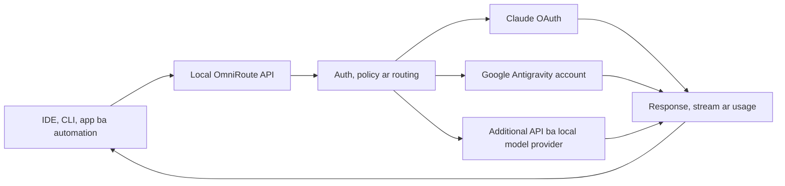

> **ঐতিহাসিক নথি — public copy, ২০২৬-১০-১৭।** মূল ঘটনার তারিখ ও ফল এই নথির নিজস্ব সময়ের জন্য প্রযোজ্য; পরের সংযোজন থাকতে পারে। বর্তমান অবস্থা ও কাজের নিয়মের জন্য [বর্তমান handoff](../CURRENT-STATUS-2026-10-17.md) পড়ুন। Private reference ও identifier সরানো হয়েছে; স্থানীয় evidence এখানে অন্তর্ভুক্ত নেই। পুরোনো cleanup, build, deploy বা service command বর্তমান অনুমতি হিসেবে ব্যবহার করবেন না।

# OmniRoute local setup: detailed review ar practical guide

Prepared for Jillur Rahman / NexaLance. Review date: 2026-10-02, Asia/Dhaka. Live checks: approximately 06:20 BST.

## Review-er scope ar evidence

Ei review local setup kit, installed runtime-er safe configuration, read-only SQLite metadata, existing request/connection-test history, backup snapshots, upstream GitHub release ar npm registry-r upor based. Credential, password, account email, token ba private request body ei report-e nei.

Source checkout: `<local-setup>/source/OmniRoute`, tag `v3.8.51`, commit `c1e30b76`. GitHub latest stable release ar npm latest duita-i review-er somoy `3.8.51`. GitHub default development branch `release/v3.8.52`; branch-er naam released version-er proman na. [Official release](https://github.com/diegosouzapw/OmniRoute/releases/tag/v3.8.51).

Repository inventory-te 10,572 Markdown/MDX/text file paoa geche: 10,273 `i18n` tree-te, 299 outside `i18n`, jar moddhe 164 canonical document `docs/`-e. Canonical document-er titles, sections ar introductions inventory kora hoyeche; task-er relevant setup, routing, API, auth, provider, backup, integration ar framework sections detail-e review kora hoyeche. Sob translation, historical changelog entry, third-party license text ba test note line-by-line pora hoyni. Companion document map puro canonical `docs/` coverage ar onno non-translation document-er path dey.

Ei turn-e configuration edit, update, restart, provider login, tool configuration, tunnel activation, paid generation ba successful inference test chalano hoyni. Health/catalog GET, unauthenticated inference-rejection probe, read-only configuration/history ar snapshot integrity check kora hoyeche. Ei report ar document map notun file hisebe add kora hoyeche.

## OmniRoute-r kaj

OmniRoute ekta self-hosted AI gateway. Tomar application ba coding client ekta base URL ar gateway API key diye request kore. Gateway selected provider-e request pathay, protocol translate kore, stream forward kore, usage record kore ar eligible fallback target thakle recover korar chesta kore. Inference selected cloud provider ba separately running local model server kore.



Upstream 350+ provider-er catalog advertise kore. Installed catalog entry, connected credential, account entitlement ar successful response alada state. Gateway-r MIT license software use/modification-er license; upstream model access-er cost ar conditions provider determine kore. [Repository](https://github.com/diegosouzapw/OmniRoute/).

## Tomar current setup

| Bishoy | Observed state | Practical meaning |
|---|---|---|
| Runtime | `omniroute@3.8.51`, Node `v24.15.0` | Current stable release-er sathe match |
| Service | `com.nexalance.omniroute`, running | LaunchAgent loaded |
| Dashboard | `http://omni.local` ar `http://127.0.0.1:28128` | Duita URL diye local gateway access |
| Health | Duita host-er `/healthz` HTTP 200 | Service respond korche |
| API | `http://127.0.0.1:28128/v1` | OpenAI-compatible client-er base URL |
| Network | Listener `127.0.0.1:28128` | Main service loopback-e |
| Helper sockets | `127.0.0.1:28131`, `127.0.0.1:28132` | Embedded/live WebSocket helpers |
| Authentication | `REQUIRE_API_KEY=true`, unauthenticated chat probe 401 | Inference API key chara reject hoy |
| Catalog auth | Key chara models 401, local key diye models 200 | Saved gateway key valid |
| Catalog | 684 returned entries | Aliases/presets/models; 684 verified working models na |
| Provider connections | `claude`, `antigravity`, `agy`; active OAuth | Credential/connection-test state active |
| Google account | `antigravity` ar `agy` stored account identity same | Shared account quota |
| Custom routing combos | 0 | Built-in auto presets ache; nijer cascade create kora hoyni |
| Gateway API keys | 1 active, `local-default` | Per-client segregation ekhono nei |
| Key scopes | `self:usage` | Current key management/MCP credential hisebe enough na |
| MCP | Enabled, `streamable-http` | Server configured; current key diye endpoint 403 |
| A2A | Enabled setting; public agent card 200 | Authenticated task execution ei review-te test hoyni |
| Compression | Global enabled false, default mode off | Normal prompt compression global-e off |
| Compression permission | Current key permits compression | Permission ar active global mode alada |
| Cache | Semantic ar prompt cache settings enabled | Actual hit/benefit ei review-te measured na |
| Logs | Detailed logs enabled, retention setting 7 days | Client content local log-e thakte pare |
| Radar | Opt-in false | Optional live catalog feed disabled |
| Custom memory/skills/evals/webhooks/plugins/pools | Table counts 0 | Feature support ache; custom configuration nei |
| Desktop | `/Applications/OmniRoute.app`, version 3.8.51 | Installed shell |
| Desktop server target | `http://127.0.0.1:28128` | Same local service-er remote-server preference |
| Secrets | `.env` ar `local-default.key` mode 600 | Local file permission restricted |
| Auto-start | ON at user login | Login-er por service start |

Latest stored connection tests around 05:44 BST-e tin provider-er jonnoi HTTP 200. Usage history-te successful chat-er record paoa jayni: initial `opencode/big-pickle` ar `auto` attempt duita 403. Provider connection test upstream generation-er equivalent na. Ei review-er conclusion: gateway healthy, authentication working ar OAuth connection state active; completed chat, streaming/tool calling ar failover still need end-to-end validation.

## Local storage ar startup

| Path | Role |
|---|---|
| `~/.omniroute-runtime/` | Installed npm runtime |
| `~/.omniroute-local/` | Live SQLite, durable environment ar local key |
| `~/Library/LaunchAgents/com.nexalance.omniroute.plist` | Login startup ar crash supervisor configuration |
| `~/Library/Logs/OmniRoute/` | Service output/error logs |
| `/Applications/OmniRoute.app` | Desktop application |
| `/Library/Application Support/OmniRoute-Local/` | Internal copy of `omni.local` TCP forwarder |
| `~/Developer/OmniRoute/` | Separate NexaLance customization fork |
| T7 setup kit | Release files, reference source, scripts ar backup |

Runtime internal disk-e thakay T7 absence service-ke direct dependency hisebe block kore na. `omni-ctl` shortcut T7-r script-er upor depend kore. Unplug test ei turn-e kora hoyni.

`omni.local` hosts mapping-er dedicated loopback alias `127.0.0.2` ar `fd6f:6d6e::2` diye root daemon-er forwarder main service-e pouchhay. Forwarder bind-er por `nobody` identity-te drop korar code ache. Ei setup Local/Flywheel-er port-80 router-er conflict avoid korar jonno design kora.

`OMNIROUTE_MEMORY_MB=8192` V8 heap-er ceiling configuration. Eta 8 GB reserve kora ba current measured RAM use na. Machine sleep, shutdown ba offline hole local request service-er availability affected hobe; cloud provider use-e internet lage.

## Ki ki kora jay

### 1. Ek endpoint diye multiple coding client

Codex CLI, Claude Code, OpenCode, Continue, Cline, Kilo Code, Roo, Aider, Goose, Qwen Code ar compatible SDK/application gateway use korte pare. OmniRoute setup helpers ar runtime launchers provide kore; protita listed integration-er detection/configuration/launch capability same na. [CLI integration guide](https://github.com/diegosouzapw/OmniRoute/blob/v3.8.51/docs/guides/CLI-INTEGRATIONS.md).

Claude Code Anthropic Messages protocol use kore; Codex CLI Responses protocol use kore. Gateway translation-er maddhome compatible upstream-ke ei client-gulor sathe use kora jay. Translation tool calling, reasoning, context length ba client-specific agent behavior-er sob difference eliminate kore na; selected combination test korte hobe.

Tomar default Codex, Claude Code ar Hermes config-e `omniroute`, `28128` ba `omni.local` marker paoa jayni. Eta default file-er limited check; extra profiles, environment overrides ba active process-er full audit na. Ei review default tool behavior change koreni.

### 2. Auto-routing ar automatic fallback

`auto` connected eligible candidates-er health, latency, cost, quota ar task fit consider kore. Built-in presets catalog-e exposed thakte pare even custom combo count zero holeo. [Auto-Combo reference](https://github.com/diegosouzapw/OmniRoute/blob/v3.8.51/docs/routing/AUTO-COMBO.md).

| Model/preset | Intent | Boundary |
|---|---|---|
| `auto` | Balanced route | Best possible answer guarantee na |
| `auto/coding` | Coding-oriented scoring | Agent workflow compatibility separately test |
| `auto/fast` | Lower-latency preference | Actual fastest provider guaranteed na |
| `auto/cheap` | Lower-cost preference | Zero extra bill-er guarantee na |
| `auto/smart` | Quality/exploration preference | Response/model variation thakte pare |
| `auto/offline` | Quota/headroom preference | Offline local inference bujhay na |
| `auto/subscription` | Verified plan-included hard-stop connections | Unverifiable/exhausted pool hole error dite pare |
| `auto/thrifty` | Subscription theke keyless/free/cheap/premium ladder | Paid fallback possible |

`auto/subscription` stricter selection dey. `auto/thrifty`-r `rungBudgetUsd` configuration v3.8.51 docs-e reserved, enforcement ekhono wired na. Oi field-ke active spending limit dhora jabe na. Existing budget/key policies-er exact enforcement chosen endpoint-e validate korte hobe. [Subscription routing](https://github.com/diegosouzapw/OmniRoute/blob/v3.8.51/docs/routing/SUBSCRIPTION_LADDER.md).

### 3. Nijer combo ar routing strategy

19 public strategy documented:

`priority`, `weighted`, `round-robin`, `context-relay`, `fill-first`, `p2c`, `random`, `least-used`, `cost-optimized`, `reset-aware`, `reset-window`, `headroom`, `strict-random`, `auto`, `lkgp`, `context-optimized`, `cache-optimized`, `fusion`, `pipeline`.

Useful examples:

- `priority`: preferred Claude target fail korle independently configured Google ba onno eligible target.
- `headroom` / `reset-window`: account quota ar reset-er upor selection.
- `lkgp`: multi-turn work-e last successful route reuse.
- `context-optimized`: context length-er fit consider.
- `cache-optimized`: cached prefix-er connection affinity prefer.
- `fusion`: several answer generate kore judge model diye synthesize; multiple upstream call cost/quota lage.
- `pipeline`: outline → draft → review type sequential model stages; final output return.

Custom combo call-er `model` field-e exact combo name use korte hoy. Model ID live catalog-e confirm kore target pin korte hobe. Tomar setup-e ekhono custom combo create kora nei.

### 4. Quota, multiple accounts ar resilience

Gateway account-level cooldown, provider circuit breaker ar model lockout alada rakhe. Eta ek account/model fail hole unnecessary bhabe sob access disable howa komate help kore. Healthy eligible alternative na thakle fallback-o answer dite parbe na.

Same provider-e authorized multiple connection manage kora jay; account policy ar actual quota sharing respect korte hobe. Tomar `antigravity` ar `agy` same Google account-er duita interface, independent capacity na. [Antigravity guide](https://github.com/diegosouzapw/OmniRoute/blob/v3.8.51/docs/guides/ANTIGRAVITY-ONBOARDING.md).

Quota telemetry unknown/stale hole exact available capacity infer kora thik na. Provider-enforced entitlement, reset ar billing-i final boundary.

### 5. Token compression ar caching

RTK command-aware terminal/test/build output filter kore. Caveman natural-language prompt shorten kore. Stacked pipelines ar history-oriented modes ache; workload onujayi savings vary kore. Advertised 15–95% range selected eligible input-er estimate, sob request-e guarantee na. [Compression guide](https://github.com/diegosouzapw/OmniRoute/blob/v3.8.51/docs/compression/COMPRESSION_GUIDE.md).

Tomar normal global compression off. `cavemanConfig.enabled=true` ba key permission thaklei global compression on hoye jay na. MCP accessibility processing-er nijer setting enabled ache, tai sob compression-related subsystem-ke uniformly off bola-o thik na.

Exact source code, Bangla writing, legal text, client instructions ar quoted material-e aggressive shortening-er quality compare kora dorkar. Semantic cache response reuse korte pare; prompt cache provider-er reusable input prefix-er cost/latency affect kore. Cache settings enabled, kintu current savings measured hoyni.

### 6. Nijer application ar local automation

Python, JavaScript/TypeScript, PHP ba OpenAI-compatible SDK diye nijer app-e gateway attach kora jay. Example use cases: client brief theke proposal draft, product description, WordPress content outline, support-message draft, structured JSON extraction, code review ar internal research assistant. Egulo proposed application workflow; setup nijer theke email send, website publish ba client action execute kore na.

Same machine-e running automation service HTTP request pathate pare. Docker container-er `localhost` container-ke refer kore; host-er endpoint reach korar networking alada configure korte hobe. Cloud-hosted workflow ba client hosting `127.0.0.1` diye tomar Mac-e pouchhabe na. Remote use-er jonno secured reachable gateway ar uptime design dorkar.

### 7. Local AI: Ollama, LM Studio, MLX

Local OpenAI-compatible model server gateway-r provider hote pare. Tokhon client same gateway URL use kore local/cloud target select korte parbe. Model weights, inference server, memory/GPU capacity ar desired context separately manage korte hoy. OmniRoute-r current tin connection-er moddhe local Ollama/LM Studio/MLX provider nei.

Tomar native service-er local provider URL ar Docker guide-er `host.docker.internal` same context na. Existing stack-e loopback local inference server use korle LAN exposure force korar dorkar nei. [Local Ollama guide](https://github.com/diegosouzapw/OmniRoute/blob/v3.8.51/docs/guides/LOCAL_OLLAMA_DOCKER.md).

### 8. Text, image, audio, video ar OCR surfaces

| Capability | API surface | Requirement |
|---|---|---|
| Chat/stream | `/v1/chat/completions` | Compatible chat connection |
| Responses | `/v1/responses` | Provider-native route ba translation |
| Anthropic Messages | `/v1/messages` | Messages-compatible gateway path |
| Embeddings | `/v1/embeddings` | Embedding provider/model |
| Images | `/v1/images/generations`, `/v1/images/edits` | Image-capable provider/model |
| Speech generation | `/v1/audio/speech` | TTS provider |
| Transcription | `/v1/audio/transcriptions` | STT provider |
| Video/music generation | `/v1/videos/generations`, `/v1/music/generations` | Supported media provider |
| OCR | API reference-er Document OCR surface | OCR provider |
| Rerank/classify/segment | `/v1/rerank`, `/v1/classify`, `/v1/segment` | Matching specialized provider |

Endpoint available thaka ar tomar account-e model entitlement thaka alada. Tin connected OAuth provider diye sob modality tested/available bola jay na. Ei review kono media generation koreni. Vision/audio/video bridge input-ke chosen text-capable route-r usable representation-e convert korte pare; native video/image generation-er sathe eta alada workflow. [API reference](https://github.com/diegosouzapw/OmniRoute/blob/v3.8.51/docs/reference/API_REFERENCE.md).

### 9. Search, scrape ar document context

`/v1/search` ar `/v1/web/fetch` configured search/fetch provider abstract kore. Search Tools Studio-te search, scrape ar compare workspace ache. Search catalog GET-e entry dekha account credential configure howar proof na. Tomar tin stored connection search-specific credential na; paid/free search execution ei review-te verified na.

Local Corpus ekta explicitly approved text directory-ke searchable kore. Markdown, text, code, CSV/JSON/HTML type file support kore; PDF, DOCX, image ba archive directly index kore na. Oigulo age text-e convert korte hobe. Default bounds 5,000 file, 1 MiB per file ar 64 MiB total. [Local Corpus](https://github.com/diegosouzapw/OmniRoute/blob/v3.8.51/docs/frameworks/LOCAL_CORPUS_CONTEXT.md).

Notion ar Obsidian context tools-o documented. Token/plugin/vault setup ar scoped access separately configure korte hoy. Apple Notes automatic import verified support hisebe ei review establish koreni; exported approved text corpus ekta practical route hote pare. Current `api_key_context_sources` count zero.

### 10. Memory ar skills

Optional persistent memory API key/session onujayi context retain ar later request-e inject korte pare. Default memory disabled; enable korle extra input token cost ar context handling affect korte pare. Local `memories` ar `skills` table empty; existing configured memory injection ei review establish koreni.

Client-wise separate key memory/log isolation-er jonno useful. Skills framework extension/execution capabilities dey; OS-level unrestricted autonomy ba onno installed application's permission automatically grant kore na. [Memory guide](https://github.com/diegosouzapw/OmniRoute/blob/v3.8.51/docs/frameworks/MEMORY.md), [Skills](https://github.com/diegosouzapw/OmniRoute/blob/v3.8.51/docs/frameworks/SKILLS.md).

### 11. MCP, A2A, ACP ar cloud task orchestration

MCP model selection, provider/quota inspection, combos, cache, compression, memory/context ar extension tools expose kore. v3.8.51-er docs 110 tools advertise kore; usable tool set configured subsystem ar permission-er upor depend kore. [MCP guide](https://github.com/diegosouzapw/OmniRoute/blob/v3.8.51/docs/frameworks/MCP-SERVER.md).

Current `local-default` key-er scopes sudhu `self:usage`; authenticated MCP endpoint-o oi key-ke 403 diyeche. Management authorization ar granular MCP tool scopes alada namespace. `manage` thaklei scope enforcement enabled thaka obosthay every `read:*`/`write:*` tool automatically allowed na. MCP tool-scope enforcement opt-in; default disabled bole sudhu granular scope label dekhei enforcement assume kora jabe na.

A2A agent discovery ar task messaging provide kore. ACP external coding agent-er process/protocol integration-e use hoy. Cloud agent subsystem Codex Cloud, Cursor, Devin ar Jules type separately authenticated service-er long-running coding task orchestrate korte pare. Required account, service configuration ar repository authorization separately lagbe. Current local task execution oi services-er sathe verified na.

### 12. Compare, Chaos, fusion, pipeline ar evaluations

Playground Chat/Compare/API/Build tabs diye selected model behavior ar request shapes inspect kora jay. Chaos Mode same task several configured model-e parallel ba collaborative bhabe pathate pare; current key-er Chaos permission off. `auto/chaos`, persisted fusion ar pipeline-r execution semantics same na.

Evals built-in/custom test suite, latency ar deterministic exact/contains/regex criteria support kore. Custom suite table empty; built-in suites memory-te register hoy bole zero DB rows mane feature absent na. Evals real upstream call korte pare; quota/cost count hobe. Docs-e LLM-as-judge similarity scoring currently implemented na bole mention ache. [Evals](https://github.com/diegosouzapw/OmniRoute/blob/v3.8.51/docs/frameworks/EVALS.md).

### 13. Usage, budgets, per-client access ar observability

Per-tool/client API key, model/connection restrictions, endpoint permissions, request/token limits, usage policies ar detailed logs available. Analytics provider, model, latency, token usage, cache ar cost estimate dekhate pare. Cost metadata missing/unpriced hole zero report howa actual billing zero-er proman na. [Usage/quota guide](https://github.com/diegosouzapw/OmniRoute/blob/v3.8.51/docs/guides/USAGE_QUOTA_GUIDE.md).

Tomar self-usage status endpoint current key diye 200 return kore. Client delivery/accounting-e provider bill, gateway estimate, allocated budget ar quota snapshot alada metric hisebe rakha uchit.

### 14. Advanced extensions ar operations

Files/Batch APIs, plugins, continuous log export, webhook dispatcher, embedded sidecar services, traffic inspection, proxies, tunnels ar optional catalog feed documented. Protita subsystem-er prerequisites ar supported runtime boundary alada.

Webhook docs `request.completed`, `request.failed`, `quota.exceeded`, `test.ping` describe kore, kintu production dispatch call sites-er kichu wiring still landing bole caveat ache. Client automation-er essential event hisebe use korar age target event live-e verify korte hobe. Current webhook config count zero.

Embedded services-er moddhe 9Router, CLIProxyAPI, Mux, Bifrost, Dario ar open-wa cataloged. Sobgulo model router na; kichu lifecycle/orchestration tool. Install ba process management authorized local loopback access require kore. Whole-system HTTPS inspection privileged/opt-in workflow; Linux TPROXY mode macOS-r native path na.

Tailscale/Cloudflare/ngrok type remote access possible, kintu current service local-only. API key, HTTPS/access controls ar uptime properly configure korar por external clients use korte parbe. External website-r public JavaScript-e gateway key rakha thik na; app-er server-side secret handling dorkar.

## Free tier ar privacy-r practical meaning

Upstream ~1.62B monthly free-token headline different provider pool-er aggregate estimate. Tomar account-e automatically oi allowance deposit hoy na. Login/API key, region/eligibility, per-provider limits ar model entitlement apply kore; initial local OpenCode Free attempt already 403 hoyechilo. [Free-tier methodology](https://github.com/diegosouzapw/OmniRoute/blob/v3.8.51/docs/reference/FREE_TIERS.md).

Strict zero-cost policy verified hard-stop connections-er upor rely kore, ambiguous access exclude korte pare. `auto/cheap` cost preference; `auto/thrifty` paid route-e escalate korte pare. Subscription account connect kora-o provider terms ba quota remove kore na.

Gateway ar control database local. Cloud provider choose korle prompt selected upstream-e jabe. Credentials-er sensitive fields encryption configured thaka mane SQLite-r sob prompt/log field encrypted na. Current detailed logging on. PII request redaction ar response sanitization opt-in feature; unconditional automatic redaction assume kora jabe na.

## Backup: actual verified state

Duita alada mechanism ache:

1. CLI scheduled backup: `backup-schedule.json`-e enabled true, cron `0 3 * * *`, retention 14, cloud false, archive encryption false. Latest recorded run `2026-10-02 03:00:21` BST. Output `~/.omniroute-local/backups/omniroute-backup-2026-10-01T21-00-21/`.
2. Dashboard SQLite automatic/pre-write backup: persisted `autoBackupEnabled=false`, frequency `never`, keep count 3. `~/.omniroute-local/db_backups/`-e file paoa jayni.

CLI latest snapshot immutable read mode-e `PRAGMA quick_check` pass kore ar 3 provider record ache. Live database-o quick-check pass kore. T7-r `backups/omniroute-20261002-011914/` snapshot check pass kore, kintu 0 provider record, karon ota provider connect-er ager.

Daily CLI backup-er metadata sudhu `storage.sqlite` file list kore; durable `.env` backup oi archive-e nei. Storage encryption key lost hole provider credential recovery-e obstacle hobe. Private durable secret backup-er existence ei review verify koreni. Full restore test ei turn-e kora hoyni.

Root README-r daily-backup path `db_backups` actual CLI output path-er sathe match kore na. Scheduled run thaka, snapshot integrity ar tested restore alada verification.

## Update flow ar customization: important mismatch

T7-r reference source v3.8.51 tag, tracked files clean. macOS AppleDouble `._*` sidecar anek untracked entry ar `.git/objects/pack/._*.idx` warning create koreche. Actual pack-er corruption ei review establish koreni; runtime internal disk-e alada install. Kono sidecar delete kora hoyni.

Separate customization fork `~/Developer/OmniRoute/`-e `nexalance` branch ache. Observed manifest upstream base 3.8.51, 31 patches, 13 new files ar 2 tooling items. Upstream tree-r upor build-time overlay model documented. Archived cloud/image examples oi fork-er older deployment evidence; current local media success-er proman na.

Current `omni-ctl.sh` dispatch:

| Command | Actual intent |
|---|---|
| `status`, `health`, `update-status` | Read status |
| `open`, `desktop` | Dashboard/desktop open |
| `start`, `stop`, `restart` | Service lifecycle |
| `backup [--with-secrets]` | New T7 snapshot |
| `features` | MCP/A2A ar CLI backup configure |
| `update` / `upgrade` | Fork-er newest upstream release → build/deploy workflow |
| `redeploy` | Current customization branch build/deploy |
| `update-npm [version]` | Stock npm package replacement; customization drop korte pare |
| `install-desktop [version]` | Official release Desktop install |

Root README `omni-ctl update [version]`-ke npm flow bole; script-er current meaning different. `update` arguments oi dispatcher-e forwarded hoy na. Runtime env-e `AUTO_UPDATE_*` variables ar installed updater LaunchAgent paoa jayni, tai dashboard updater hook fully wired bole report kora jay na.

Updater script build cleanup, app replacement ar fork push kore; deployment-er age explicit database snapshot step dekha jayni. Eita read-only status command na. Ei review updater run ba kono custom build deploy koreni. Running package version matching diye overlay deployed kina establish kora jay na.

## Tomar jonno practical adoption order

1. **Ekta direct model-er small end-to-end test:** current catalog-er exact ID diye response, streaming ar usage verify.
2. **Ekta coding client-er separate profile:** existing default config preserve kore gateway attach; tool calling/context behavior test.
3. **Per-client key:** personal coding, research ar future client automation-er permission/usage alada.
4. **Independent fallback:** same Google account-er duita interface-ke independent capacity dhore cascade design koro na.
5. **Known-good combo:** actual model IDs ar account connections pin kore unavailable-target fallback verify.
6. **Compression A/B check:** long terminal/test output-e RTK compare; exact instructions ar Bangla quality inspect.
7. **Approved project corpus:** ek client-er cleaned text docs diye search/read scope; binary documents age convert.
8. **Local provider optional:** available Ollama/MLX/LM Studio model server connect kore cloud dependency komao.
9. **Backup/update document reconcile:** CLI-vs-dashboard backup ar fork-vs-npm update semantics clear kore restore plan test.
10. **Remote application later:** accessible server, secret handling, quota policy ar uptime verify kore externally hosted app connect.

Ei steps recommendation. Ei review-egulo implement kora hoyni.

## Useful read-only commands ar connection template

```bash
omni-ctl status
omni-ctl health
omni-ctl update-status
omni-ctl cli backup auto status
omni-ctl cli setup-codex --help
omni-ctl cli setup-claude --help
```

Generic client:

```text
Base URL: http://127.0.0.1:28128/v1
API key: local gateway key, handled as a secret
Model: exact returned model ID ba selected auto preset
```

Claude Code-r Anthropic base URL gateway root (`http://127.0.0.1:28128`); client `/v1/messages` append kore. Codex CLI provider base URL `/v1` include kore ar `wire_api="responses"` use kore. Onno client-er convention setup guide-e check korte hobe; sob client-er jonno blindly `/v1` append koro na.

Local catalog dekhar example, key output-e print na kore:

```bash
curl --silent --show-error http://127.0.0.1:28128/v1/models \
  -H "Authorization: Bearer $(cat ~/.omniroute-local/local-default.key)"
```

## Main reading paths

Start: `docs/README.md`, `docs/getting-started/`, `docs/guides/USER_GUIDE.md`.

Client setup: `docs/guides/CLI-INTEGRATIONS.md`, `CODEX-CLI-CONFIGURATION.md`, `CLAUDE-CODE-CONFIGURATION.md`.

Routing/cost: `docs/routing/AUTO-COMBO.md`, `SUBSCRIPTION_LADDER.md`, `STRICT_ZERO_COST.md`, `QUOTA_SHARE.md`, `docs/guides/USAGE_QUOTA_GUIDE.md`.

Apps/context: `docs/reference/API_REFERENCE.md`, `docs/frameworks/MCP-SERVER.md`, `LOCAL_CORPUS_CONTEXT.md`, `MEMORY.md`, `SKILLS.md`, `EVALS.md`.

Operations/security: `docs/ops/DATABASE_GUIDE.md`, `MONITORING_GUIDE.md`, `docs/security/INFERENCE_AUTH_POSTURE.md`, `ROUTE_GUARD_TIERS.md`, `COMPLIANCE.md`.

Full path/section index companion: `OMNIROUTE-DOCUMENT-MAP-2026-10-02.md`.
