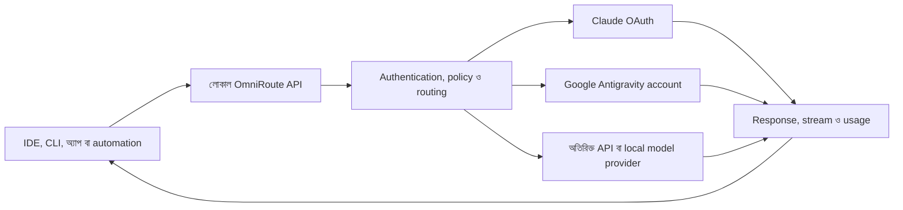

> **ঐতিহাসিক নথি — public copy, ২০২৬-১০-১৭।** মূল ঘটনার তারিখ ও ফল এই নথির নিজস্ব সময়ের জন্য প্রযোজ্য; পরের সংযোজন থাকতে পারে। বর্তমান অবস্থা ও কাজের নিয়মের জন্য [বর্তমান handoff](../CURRENT-STATUS-2026-10-17.md) পড়ুন। Private reference ও identifier সরানো হয়েছে; স্থানীয় evidence এখানে অন্তর্ভুক্ত নেই। পুরোনো cleanup, build, deploy বা service command বর্তমান অনুমতি হিসেবে ব্যবহার করবেন না।

# OmniRoute লোকাল সেটআপ: বিস্তারিত পর্যালোচনা ও ব্যবহারিক নির্দেশিকা

প্রস্তুত: Jillur Rahman / NexaLance। পর্যালোচনার তারিখ: ২ অক্টোবর ২০২৬, Asia/Dhaka। মূল সরাসরি যাচাইয়ের সময়: আনুমানিক সকাল ৬:২০, বাংলাদেশ সময়।

এটি আগের বিস্তারিত রিপোর্টের বাংলা সংস্করণ। এখানে মূল পর্যবেক্ষণ, প্রমাণ ও যাচাইয়ের সীমা বজায় রাখা হয়েছে। অনুবাদের এই ধাপে নতুন করে সার্ভিস বা provider পরীক্ষা করা হয়নি।

## পর্যালোচনার পরিধি ও প্রমাণ

এই পর্যালোচনায় লোকাল setup kit, ইনস্টল করা runtime-এর সংবেদনশীল নয় এমন configuration, read-only SQLite metadata, সংরক্ষিত request ও connection-test history, backup snapshot, upstream GitHub release এবং npm registry ব্যবহার করা হয়েছে। Password, API key-এর আসল মান, account email, token বা ব্যক্তিগত request body রিপোর্টে রাখা হয়নি।

Reference source checkout: `<local-setup>/source/OmniRoute`; tag `v3.8.51`, commit `c1e30b76`। মূল পর্যালোচনার সময় GitHub-এর সর্বশেষ stable release এবং npm-এর latest সংস্করণ দুটিই `3.8.51` ছিল। GitHub-এর default development branch ছিল `release/v3.8.52`; branch-এর নাম প্রকাশিত release-এর প্রমাণ নয়। [অফিশিয়াল release](https://github.com/diegosouzapw/OmniRoute/releases/tag/v3.8.51)।

Repository inventory-তে মোট ১০,৫৭২টি Markdown/MDX/text file পাওয়া গেছে। এর মধ্যে ১০,২৭৩টি `i18n` directory tree-তে এবং ২৯৯টি তার বাইরে। `docs/`-এর মূল documentation file ছিল ১৬৪টি। মূল document-এর শিরোনাম, section ও ভূমিকার তালিকা করা হয়েছে; setup, routing, API, authentication, provider, backup, integration এবং framework-এর প্রাসঙ্গিক অংশ বিস্তারিত পর্যালোচনা করা হয়েছে। সব অনুবাদ, পুরোনো changelog entry, third-party license text বা test note লাইন ধরে পড়া হয়নি। আলাদা document map-এ মূল documentation ও অন্যান্য অনুবাদবহির্ভূত document-এর path আছে।

মূল পর্যালোচনায় configuration পরিবর্তন, update, restart, provider login, coding tool configuration, tunnel activation, paid generation বা সফল inference test চালানো হয়নি। Health/catalog GET request, authentication ছাড়া inference প্রত্যাখ্যানের পরীক্ষা, read-only configuration/history এবং snapshot integrity check করা হয়েছে। রিপোর্ট ও document map নতুন file হিসেবে যোগ করা হয়েছিল; এই বাংলা সংস্করণও নতুন file।

## OmniRoute কীভাবে কাজ করে

OmniRoute একটি self-hosted AI gateway। তোমার application বা coding client একটি base URL এবং gateway API key ব্যবহার করে request পাঠায়। Gateway নির্বাচিত provider-এর কাছে request পাঠায়, প্রয়োজন হলে protocol translate করে, response stream ফেরত দেয়, usage record করে এবং যোগ্য বিকল্প target থাকলে ব্যর্থ request থেকে পুনরুদ্ধারের চেষ্টা করে। আসল inference নির্বাচিত cloud provider অথবা আলাদাভাবে চলতে থাকা local model server করে।



Upstream ৩৫০টির বেশি provider-এর catalog প্রচার করে। Catalog-এ entry থাকা, credential connect করা, account-এ model ব্যবহারের অধিকার থাকা এবং সফল response পাওয়া আলাদা অবস্থা। Gateway-এর MIT license সফটওয়্যার ব্যবহার ও পরিবর্তনের অনুমতি দেয়; upstream model ব্যবহারের খরচ ও শর্ত provider নির্ধারণ করে। [Repository](https://github.com/diegosouzapw/OmniRoute/)।

## তোমার সেটআপের পর্যবেক্ষিত অবস্থা

| বিষয় | যা পাওয়া গেছে | ব্যবহারিক অর্থ |
|---|---|---|
| Runtime | `omniroute@3.8.51`, Node `v24.15.0` | পর্যালোচনার সময় stable release-এর সঙ্গে মিলে গেছে |
| Service | `com.nexalance.omniroute`, running | LaunchAgent চালু ছিল |
| Dashboard | `http://omni.local` এবং `http://127.0.0.1:28128` | দুই ঠিকানাতেই লোকাল gateway পাওয়া যায় |
| Health | দুই host-এর `/healthz` HTTP 200 | সার্ভিস response দিচ্ছিল |
| API | `http://127.0.0.1:28128/v1` | OpenAI-compatible client-এর base URL |
| Network | Listener `127.0.0.1:28128` | মূল সার্ভিস loopback-এ |
| Helper sockets | `127.0.0.1:28131`, `127.0.0.1:28132` | Embedded/live WebSocket helper |
| Authentication | `REQUIRE_API_KEY=true`; key ছাড়া chat probe 401 | Inference API key ছাড়া request প্রত্যাখ্যান করে |
| Catalog authentication | Key ছাড়া models 401; লোকাল key দিয়ে 200 | সংরক্ষিত gateway key কার্যকর ছিল |
| Catalog | ৬৮৪টি entry | Model, alias ও preset; ৬৮৪টি পরীক্ষিত কার্যকর model নয় |
| Provider connection | `claude`, `antigravity`, `agy`; active OAuth | Credential/connection-test state সক্রিয় |
| Google account | `antigravity` ও `agy`-তে একই সংরক্ষিত account identity | Account quota ভাগ করা |
| Custom routing combo | ০ | Built-in auto preset আছে; নিজস্ব cascade তৈরি হয়নি |
| Gateway API key | ১টি active, `local-default` | Client অনুযায়ী আলাদা key নেই |
| Key scope | `self:usage` | এই key management/MCP ব্যবহারের জন্য যথেষ্ট নয় |
| MCP | Enabled, `streamable-http` | Server configured; বর্তমান key দিয়ে endpoint 403 |
| A2A | Setting enabled; public agent card 200 | Authenticated task execution পরীক্ষা হয়নি |
| Compression | Global enabled false; default mode off | সাধারণ prompt compression বন্ধ |
| Compression permission | বর্তমান key compression অনুমোদন করে | অনুমতি ও সক্রিয় global mode আলাদা |
| Cache | Semantic ও prompt cache setting enabled | প্রকৃত cache hit বা সুবিধা মাপা হয়নি |
| Logs | Detailed logs enabled; retention setting ৭ দিন | Client content লোকাল log-এ থাকতে পারে |
| Radar | Opt-in false | ঐচ্ছিক live catalog feed বন্ধ |
| Custom memory/skills/evals/webhooks/plugins/pools | সংশ্লিষ্ট table-এ record ০ | Feature আছে; custom configuration নেই |
| Desktop | `/Applications/OmniRoute.app`, version 3.8.51 | Desktop application ইনস্টল করা |
| Desktop server target | `http://127.0.0.1:28128` | একই লোকাল সার্ভিস ব্যবহারের preference |
| Secrets | `.env` ও `local-default.key` mode 600 | File permission সীমিত |
| Auto-start | User login-এ ON | Login-এর পরে সার্ভিস চালু হয় |

সর্বশেষ সংরক্ষিত connection test-এ আনুমানিক সকাল ৫:৪৪, বাংলাদেশ সময়ে তিন provider-এর জন্যই HTTP 200 ছিল। Usage history-তে সফল chat-এর record পাওয়া যায়নি: প্রথম `opencode/big-pickle` এবং `auto` attempt দুটিই 403 হয়েছিল। Provider connection test সফল হওয়া model generation সফল হওয়ার সমান প্রমাণ নয়।

পর্যবেক্ষণ অনুযায়ী gateway সুস্থভাবে চলছিল, authentication কাজ করছিল এবং OAuth connection সক্রিয় ছিল। সফল chat, streaming, tool calling এবং failover-এর end-to-end যাচাই তখনও বাকি ছিল।

## লোকাল storage ও startup

| Path | কাজ |
|---|---|
| `~/.omniroute-runtime/` | ইনস্টল করা npm runtime |
| `~/.omniroute-local/` | Live SQLite, স্থায়ী environment configuration ও লোকাল key |
| `~/Library/LaunchAgents/com.nexalance.omniroute.plist` | Login startup ও crash supervisor configuration |
| `~/Library/Logs/OmniRoute/` | Service output/error log |
| `/Applications/OmniRoute.app` | Desktop application |
| `/Library/Application Support/OmniRoute-Local/` | `omni.local` TCP forwarder-এর internal copy |
| `~/Developer/OmniRoute/` | আলাদা NexaLance customization fork |
| T7 setup kit | Release file, reference source, script ও backup |

Runtime internal disk-এ রাখা। তাই T7 না থাকলেও runtime-এর সরাসরি T7 dependency নেই। তবে `omni-ctl` shortcut T7-তে থাকা script-এর ওপর নির্ভর করে। মূল পর্যালোচনায় drive খুলে বাস্তব পরীক্ষা করা হয়নি।

`omni.local`-এর hosts mapping dedicated loopback alias `127.0.0.2` এবং `fd6f:6d6e::2` ব্যবহার করে। Root daemon-এর forwarder এই ঠিকানাগুলো থেকে মূল সার্ভিসে traffic পাঠায়। Port bind করার পর `nobody` user-এ নেমে যাওয়ার code আছে। Local/Flywheel-এর port-80 router-এর সঙ্গে conflict এড়ানোর জন্য এই ব্যবস্থা করা হয়েছে।

`OMNIROUTE_MEMORY_MB=8192` হলো V8 heap-এর সর্বোচ্চ সীমার configuration। এর অর্থ ৮ GB RAM আগে থেকে বরাদ্দ করা বা বাস্তবে ৮ GB ব্যবহার হওয়া নয়। Computer sleep, shutdown বা offline হলে local service-এর availability প্রভাবিত হবে। Cloud provider ব্যবহারে internet লাগে।

## ১. এক endpoint দিয়ে একাধিক coding client

Codex CLI, Claude Code, OpenCode, Continue, Cline, Kilo Code, Roo, Aider, Goose, Qwen Code এবং compatible SDK/application gateway ব্যবহার করতে পারে। OmniRoute setup helper ও runtime launcher দেয়। তবে তালিকায় থাকা প্রতিটি integration-এর detection, configuration ও launch capability এক নয়। [CLI integration guide](https://github.com/diegosouzapw/OmniRoute/blob/v3.8.51/docs/guides/CLI-INTEGRATIONS.md)।

Claude Code Anthropic Messages protocol ব্যবহার করে; Codex CLI Responses protocol ব্যবহার করে। Gateway translation-এর মাধ্যমে উপযুক্ত upstream provider-কে এসব client-এর সঙ্গে ব্যবহার করা যায়। Translation থাকলেও tool calling, reasoning, context length বা client-specific agent behavior-এর সব পার্থক্য দূর হয় না। নির্বাচিত client ও model-এর সমন্বয় পরীক্ষা করতে হবে।

তোমার default Codex, Claude Code ও Hermes configuration file-এ `omniroute`, `28128` বা `omni.local` marker পাওয়া যায়নি। এটি default file-এর সীমিত পরীক্ষা; extra profile, environment override বা চলমান process-এর পূর্ণ audit নয়। মূল পর্যালোচনায় এসব tool-এর default behavior বদলানো হয়নি।

## ২. Auto-routing ও automatic fallback

`auto` সংযুক্ত ও যোগ্য candidate-এর health, latency, cost, quota এবং task-এর সঙ্গে উপযোগিতা বিবেচনা করে। Custom combo শূন্য হলেও built-in preset catalog-এ থাকতে পারে। [Auto-Combo reference](https://github.com/diegosouzapw/OmniRoute/blob/v3.8.51/docs/routing/AUTO-COMBO.md)।

| Model/preset | উদ্দেশ্য | সীমা |
|---|---|---|
| `auto` | ভারসাম্য রেখে route নির্বাচন | সর্বোত্তম উত্তর নিশ্চিত করে না |
| `auto/coding` | Coding-উপযোগী scoring | Agent workflow compatibility আলাদাভাবে পরীক্ষা করতে হবে |
| `auto/fast` | কম latency-কে অগ্রাধিকার | বাস্তবে সবসময় সবচেয়ে দ্রুত হবে এমন নিশ্চয়তা নেই |
| `auto/cheap` | কম খরচকে অগ্রাধিকার | অতিরিক্ত বিল শূন্য থাকার নিশ্চয়তা নয় |
| `auto/smart` | Quality ও exploration-কে অগ্রাধিকার | Model ও উত্তরে পরিবর্তন হতে পারে |
| `auto/offline` | Quota/headroom-কে অগ্রাধিকার | Internet ছাড়া local inference বোঝায় না |
| `auto/subscription` | যাচাইকৃত plan-included ও hard-stop connection | Quota অজানা বা শেষ হলে error দিতে পারে |
| `auto/thrifty` | Subscription থেকে keyless/free/cheap/premium ধাপে যাওয়া | Paid fallback হতে পারে |

`auto/subscription` তুলনামূলক কঠোর selection করে। v3.8.51 documentation অনুযায়ী `auto/thrifty`-এর `rungBudgetUsd` configuration সংরক্ষিত field; enforcement তখনও যুক্ত হয়নি। এটিকে কার্যকর খরচের সীমা ধরা যাবে না। অন্য budget/key policy-এর enforcement নির্বাচিত endpoint-এ যাচাই করতে হবে। [Subscription routing](https://github.com/diegosouzapw/OmniRoute/blob/v3.8.51/docs/routing/SUBSCRIPTION_LADDER.md)।

## ৩. নিজস্ব combo ও routing strategy

Documentation-এ ১৯টি public strategy আছে:

`priority`, `weighted`, `round-robin`, `context-relay`, `fill-first`, `p2c`, `random`, `least-used`, `cost-optimized`, `reset-aware`, `reset-window`, `headroom`, `strict-random`, `auto`, `lkgp`, `context-optimized`, `cache-optimized`, `fusion`, `pipeline`।

কয়েকটির ব্যবহার:

- `priority`: পছন্দের Claude target ব্যর্থ হলে আলাদাভাবে configured Google বা অন্য যোগ্য target চেষ্টা করা।
- `headroom` / `reset-window`: অবশিষ্ট account quota ও reset-এর ভিত্তিতে নির্বাচন।
- `lkgp`: একাধিক turn-এর কাজে সর্বশেষ সফল route আবার ব্যবহার।
- `context-optimized`: request-এর context length অনুযায়ী উপযুক্ত target নির্বাচন।
- `cache-optimized`: cached prefix থাকা connection-কে অগ্রাধিকার।
- `fusion`: একাধিক model-এর উত্তর নিয়ে judge model দিয়ে সমন্বিত উত্তর তৈরি; একাধিক upstream call-এর quota ও খরচ লাগে।
- `pipeline`: outline → draft → review-এর মতো ধাপে model চালিয়ে শেষ ফল ফেরত দেওয়া।

Custom combo ব্যবহার করতে request-এর `model` field-এ সেই combo-এর সঠিক নাম দিতে হয়। Target pin করার আগে live catalog-এ model ID আছে কি না নিশ্চিত করতে হবে। তোমার পর্যবেক্ষিত সেটআপে custom combo তৈরি করা ছিল না।

## ৪. Quota, একাধিক account ও ব্যর্থতা সামলানো

Gateway account-level cooldown, provider circuit breaker এবং model lockout আলাদাভাবে পরিচালনা করে। ফলে একটি account বা model ব্যর্থ হলে অপ্রয়োজনে সব access বন্ধ হওয়ার ঝুঁকি কমে। সুস্থ ও যোগ্য বিকল্প না থাকলে fallback-ও উত্তর দিতে পারবে না।

একই provider-এর একাধিক অনুমোদিত connection পরিচালনা করা যায়। Account policy ও বাস্তব quota sharing মানতে হবে। তোমার `antigravity` ও `agy` একই Google account-এর দুটি interface; তাদের capacity স্বাধীন নয়। [Antigravity guide](https://github.com/diegosouzapw/OmniRoute/blob/v3.8.51/docs/guides/ANTIGRAVITY-ONBOARDING.md)।

Quota telemetry অজানা বা পুরোনো হলে ঠিক কত capacity অবশিষ্ট আছে অনুমান করা উচিত নয়। Provider-এর entitlement, reset ও billing-ই চূড়ান্ত সীমা।

## ৫. Token compression ও caching

RTK command-এর ধরন বুঝে terminal/test/build output filter করে। Caveman স্বাভাবিক ভাষার prompt ছোট করে। Stacked pipeline ও conversation history-ভিত্তিক mode-ও আছে। Savings কাজের ধরন অনুযায়ী বদলায়। প্রচারিত ১৫–৯৫% range নির্দিষ্ট উপযুক্ত input-এর estimate; সব request-এর নিশ্চয়তা নয়। [Compression guide](https://github.com/diegosouzapw/OmniRoute/blob/v3.8.51/docs/compression/COMPRESSION_GUIDE.md)।

তোমার সাধারণ global compression বন্ধ ছিল। `cavemanConfig.enabled=true` বা key-তে permission থাকলেই global compression চালু হয় না। MCP accessibility processing-এর নিজস্ব setting enabled ছিল; তাই compression-সংক্রান্ত প্রতিটি subsystem বন্ধ বলাও ঠিক হবে না।

হুবহু source code, বাংলা লেখা, আইনি text, client instruction ও উদ্ধৃত material-এর ক্ষেত্রে বেশি compression চালুর আগে ফলের মান তুলনা করা দরকার। Semantic cache আগের response আবার ব্যবহার করতে পারে। Prompt cache provider-এর reusable input prefix-এর খরচ ও latency প্রভাবিত করে। Cache setting enabled ছিল, কিন্তু বাস্তব savings মাপা হয়নি।

## ৬. নিজস্ব application ও local automation

Python, JavaScript/TypeScript, PHP বা OpenAI-compatible SDK দিয়ে নিজস্ব app-এর সঙ্গে gateway যুক্ত করা যায়। সম্ভাব্য ব্যবহার: client brief থেকে proposal draft, product description, WordPress content outline, support-message draft, structured JSON extraction, code review এবং internal research assistant। এগুলো নির্মাণযোগ্য workflow; বর্তমান সেটআপ নিজে থেকে email পাঠায়, website প্রকাশ করে বা client-এর পক্ষে action নেয় এমন প্রমাণ নেই।

একই computer-এ চলতে থাকা automation service HTTP request পাঠাতে পারে। Docker container-এর `localhost` সেই container-কেই বোঝায়; host-এর endpoint-এ পৌঁছানোর networking আলাদাভাবে configure করতে হয়। Cloud-hosted workflow বা client hosting থেকে `127.0.0.1` দিয়ে তোমার Mac-এ পৌঁছানো যাবে না। Remote ব্যবহারের জন্য নিরাপদে পৌঁছানো যায় এমন gateway ও uptime পরিকল্পনা দরকার।

## ৭. Local AI: Ollama, LM Studio ও MLX

Local OpenAI-compatible model server gateway-এর provider হতে পারে। তখন client একই gateway URL দিয়ে local বা cloud target নির্বাচন করতে পারবে। Model weight, inference server, memory/GPU capacity এবং প্রয়োজনীয় context আলাদাভাবে পরিচালনা করতে হয়। পর্যবেক্ষিত তিন connection-এর মধ্যে Ollama/LM Studio/MLX provider ছিল না।

তোমার native service-এর local provider URL এবং Docker guide-এর `host.docker.internal` একই networking পরিস্থিতি নয়। Existing stack-এ loopback local inference server ব্যবহার করলে LAN exposure বাধ্যতামূলক নয়। [Local Ollama guide](https://github.com/diegosouzapw/OmniRoute/blob/v3.8.51/docs/guides/LOCAL_OLLAMA_DOCKER.md)।

## ৮. Text, image, audio, video ও OCR

| সুবিধা | API surface | যা প্রয়োজন |
|---|---|---|
| Chat/stream | `/v1/chat/completions` | Compatible chat connection |
| Responses | `/v1/responses` | Provider-native route অথবা translation |
| Anthropic Messages | `/v1/messages` | Messages-compatible gateway path |
| Embeddings | `/v1/embeddings` | Embedding provider/model |
| Image | `/v1/images/generations`, `/v1/images/edits` | Image-capable provider/model |
| Speech generation | `/v1/audio/speech` | TTS provider |
| Transcription | `/v1/audio/transcriptions` | STT provider |
| Video/music generation | `/v1/videos/generations`, `/v1/music/generations` | Supported media provider |
| OCR | API reference-এর Document OCR surface | OCR provider |
| Rerank/classify/segment | `/v1/rerank`, `/v1/classify`, `/v1/segment` | উপযুক্ত specialized provider |

Endpoint থাকা এবং তোমার account-এ সেই model ব্যবহারের অধিকার থাকা আলাদা বিষয়। তিনটি connected OAuth provider দিয়ে সব modality পাওয়া যাবে বা পরীক্ষা করা হয়েছে বলা যাবে না। মূল পর্যালোচনায় media generation করা হয়নি। Vision/audio/video bridge input-কে নির্বাচিত text-capable route-এর উপযোগী representation-এ বদলাতে পারে; native image/video generation আলাদা workflow। [API reference](https://github.com/diegosouzapw/OmniRoute/blob/v3.8.51/docs/reference/API_REFERENCE.md)।

## ৯. Search, scraping ও document context

`/v1/search` ও `/v1/web/fetch` configured search/fetch provider-এর জন্য একীভূত interface দেয়। Search Tools Studio-তে search, scrape এবং compare workspace আছে। Search catalog GET-এ entry দেখা credential configure হওয়ার প্রমাণ নয়। তোমার তিনটি সংরক্ষিত connection search-specific credential নয়; paid/free search execution মূল পর্যালোচনায় যাচাই করা হয়নি।

Local Corpus একটি স্পষ্টভাবে অনুমোদিত text directory searchable করে। Markdown, text, code, CSV/JSON/HTML ধরনের file সমর্থিত। PDF, DOCX, image বা archive সরাসরি index হয় না; আগে উপযুক্ত text format-এ রূপান্তর করতে হবে। Default সীমা: ৫,০০০ file, প্রতি file ১ MiB এবং মোট ৬৪ MiB indexed content। [Local Corpus](https://github.com/diegosouzapw/OmniRoute/blob/v3.8.51/docs/frameworks/LOCAL_CORPUS_CONTEXT.md)।

Notion ও Obsidian context tool-ও documented। Token/plugin/vault setup এবং scoped access আলাদাভাবে configure করতে হবে। Apple Notes automatic import সমর্থিত ও পরীক্ষিত বলে এই পর্যালোচনা প্রতিষ্ঠা করেনি। Export করা অনুমোদিত text corpus ব্যবহার একটি সম্ভাব্য পথ। পর্যবেক্ষিত `api_key_context_sources` record ছিল শূন্য।

## ১০. Memory ও skills

ঐচ্ছিক persistent memory API key/session অনুযায়ী context ধরে রেখে পরবর্তী request-এ যোগ করতে পারে। Default memory disabled। চালু করলে বাড়তি input token cost ও context handling প্রভাবিত হতে পারে। Local `memories` ও `skills` table খালি ছিল; সক্রিয়ভাবে configured memory injection এই পর্যালোচনায় প্রতিষ্ঠিত হয়নি।

Client অনুযায়ী আলাদা key memory ও log আলাদা রাখতে সাহায্য করতে পারে। Skills framework extension/execution capability দেয়; OS-এর unrestricted permission বা অন্য installed app-এর অনুমতি স্বয়ংক্রিয়ভাবে দেয় না। [Memory guide](https://github.com/diegosouzapw/OmniRoute/blob/v3.8.51/docs/frameworks/MEMORY.md), [Skills](https://github.com/diegosouzapw/OmniRoute/blob/v3.8.51/docs/frameworks/SKILLS.md)।

## ১১. MCP, A2A, ACP ও cloud task orchestration

MCP model selection, provider/quota inspection, combo, cache, compression, memory/context ও extension tool expose করে। v3.8.51 documentation-এ ১১০টি tool প্রচার করা হয়েছে; ব্যবহারযোগ্য tool set configured subsystem ও permission-এর ওপর নির্ভর করে। [MCP guide](https://github.com/diegosouzapw/OmniRoute/blob/v3.8.51/docs/frameworks/MCP-SERVER.md)।

বর্তমান `local-default` key-এর scope শুধু `self:usage`; authenticated MCP endpoint-ও এই key-কে 403 দিয়েছিল। Management authorization ও granular MCP tool scope আলাদা namespace। Scope enforcement চালু থাকলে শুধু `manage` থাকলেই সব `read:*`/`write:*` tool অনুমোদিত হয় না। MCP tool-scope enforcement opt-in; default disabled। শুধু scope-এর label দেখে enforcement কার্যকর ধরে নেওয়া যাবে না।

A2A agent discovery ও task messaging দেয়। ACP external coding agent-এর process/protocol integration-এ ব্যবহার হয়। Cloud agent subsystem Codex Cloud, Cursor, Devin ও Jules-এর মতো আলাদাভাবে authenticated service-এর দীর্ঘমেয়াদি coding task orchestrate করতে পারে। প্রয়োজনীয় account, service configuration ও repository authorization আলাদাভাবে লাগবে। বর্তমান local task execution ওই service-গুলোর সঙ্গে যাচাই করা হয়নি।

## ১২. Compare, Chaos, fusion, pipeline ও evaluation

Playground-এর Chat/Compare/API/Build tab দিয়ে নির্বাচিত model-এর behavior ও request structure দেখা যায়। Chaos Mode একই task একাধিক configured model-এ parallel বা collaborative পদ্ধতিতে পাঠাতে পারে। বর্তমান key-এর Chaos permission বন্ধ ছিল। `auto/chaos`, persisted fusion ও pipeline-এর execution একইভাবে কাজ করে না।

Evals built-in/custom test suite, latency এবং deterministic exact/contains/regex criteria সমর্থন করে। Custom suite table খালি ছিল; built-in suite memory-তে register হয়, তাই database-এ শূন্য record মানেই feature অনুপস্থিত নয়। Evals বাস্তব upstream call করতে পারে এবং quota/cost ব্যবহার হয়। Documentation অনুযায়ী LLM-as-judge similarity scoring তখনও implemented ছিল না। [Evals](https://github.com/diegosouzapw/OmniRoute/blob/v3.8.51/docs/frameworks/EVALS.md)।

## ১৩. Usage, budget, client অনুযায়ী access ও monitoring

প্রতি tool/client-এর API key, model/connection restriction, endpoint permission, request/token limit, usage policy ও detailed log পাওয়া যায়। Analytics provider, model, latency, token usage, cache ও cost estimate দেখাতে পারে। Pricing metadata অনুপস্থিত হলে zero cost দেখানো প্রকৃত বিল শূন্য হওয়ার প্রমাণ নয়। [Usage/quota guide](https://github.com/diegosouzapw/OmniRoute/blob/v3.8.51/docs/guides/USAGE_QUOTA_GUIDE.md)।

তোমার self-usage status endpoint বর্তমান key দিয়ে 200 ফিরিয়েছিল। Client accounting-এর ক্ষেত্রে provider bill, gateway estimate, allocated budget ও quota snapshot আলাদা metric হিসেবে রাখা উচিত।

## ১৪. Advanced extension ও operation

Files/Batch API, plugin, continuous log export, webhook dispatcher, embedded sidecar service, traffic inspection, proxy, tunnel ও optional catalog feed documented। প্রতিটি subsystem-এর prerequisite ও supported runtime আলাদা।

Webhook documentation-এ `request.completed`, `request.failed`, `quota.exceeded` এবং `test.ping` event আছে। তবে কিছু production dispatch call site-এর wiring তখনও যোগ করা হচ্ছিল বলে caveat আছে। Client automation-এর গুরুত্বপূর্ণ event হিসেবে ব্যবহারের আগে নির্বাচিত event বাস্তবে যাচাই করতে হবে। পর্যবেক্ষিত webhook configuration ছিল শূন্য।

Embedded service catalog-এ 9Router, CLIProxyAPI, Mux, Bifrost, Dario ও open-wa আছে। সবগুলো model router নয়; কিছু lifecycle/orchestration tool। Install ও process management-এর জন্য অনুমোদিত local loopback access লাগে। পুরো system-এর HTTPS inspection privileged/opt-in workflow। Linux TPROXY mode macOS-এর native ব্যবস্থা নয়।

Tailscale/Cloudflare/ngrok দিয়ে remote access করা সম্ভব, কিন্তু পর্যবেক্ষিত মূল service local-only ছিল। API key, HTTPS/access control এবং uptime সঠিকভাবে configure করার পরে বাইরের client ব্যবহার করতে পারবে। Public website-এর JavaScript-এ gateway key রাখা উচিত নয়; application-এর server-side secret handling প্রয়োজন।

## Free tier ও privacy-এর বাস্তব অর্থ

Upstream-এর প্রায় ১.৬২ বিলিয়ন monthly free-token headline বিভিন্ন provider pool-এর সম্মিলিত estimate। তোমার account-এ এই allowance স্বয়ংক্রিয়ভাবে জমা হয় না। Login/API key, region/eligibility, provider limit ও model entitlement প্রযোজ্য। প্রথম local OpenCode Free attempt 403 হয়েছিল। [Free-tier methodology](https://github.com/diegosouzapw/OmniRoute/blob/v3.8.51/docs/reference/FREE_TIERS.md)।

Strict zero-cost policy যাচাইকৃত hard-stop connection-এর ওপর নির্ভর করে; অনিশ্চিত access বাদ দিতে পারে। `auto/cheap` কম খরচকে অগ্রাধিকার দেয়, আর `auto/thrifty` paid route-এ যেতে পারে। Subscription account connect করা provider-এর শর্ত বা quota সরিয়ে দেয় না।

Gateway ও control database local। Cloud provider নির্বাচন করলে prompt সেই upstream-এ যাবে। Credential-এর sensitive field encryption configured থাকার অর্থ SQLite-এর সব prompt/log field encrypted নয়। Detailed logging চালু ছিল। PII request redaction ও response sanitization opt-in feature; সবসময় স্বয়ংক্রিয় redaction হচ্ছে ধরে নেওয়া যাবে না।

## Backup-এর যাচাইকৃত অবস্থা

দুটি আলাদা ব্যবস্থা পাওয়া গেছে:

1. **CLI scheduled backup:** `backup-schedule.json`-এ enabled true; cron `0 3 * * *`; retention 14; cloud false; archive encryption false। সর্বশেষ recorded run `2026-10-02 03:00:21`, বাংলাদেশ সময়। Output `~/.omniroute-local/backups/omniroute-backup-2026-10-01T21-00-21/`।
2. **Dashboard SQLite automatic/pre-write backup:** সংরক্ষিত `autoBackupEnabled=false`; frequency `never`; keep count 3। `~/.omniroute-local/db_backups/`-এ file পাওয়া যায়নি।

সর্বশেষ CLI snapshot immutable read mode-এ `PRAGMA quick_check` pass করেছে এবং তাতে ৩টি provider record ছিল। Live database-ও quick-check pass করেছে। T7-এর `backups/omniroute-20261002-011914/` snapshot check pass করেছে, কিন্তু provider record ছিল ০; সেটি provider connect করার আগের backup।

Daily CLI backup-এর metadata শুধু `storage.sqlite` file তালিকাভুক্ত করে; স্থায়ী `.env` সেই archive-এ নেই। Storage encryption key হারালে provider credential পুনরুদ্ধারে সমস্যা হবে। আলাদা private secret backup আছে কি না এই পর্যালোচনায় যাচাই হয়নি। Full restore test-ও করা হয়নি।

Root README-এর daily-backup path `db_backups` বাস্তব CLI output path-এর সঙ্গে মেলে না। Schedule চলা, snapshot integrity এবং সফল restore আলাদা যাচাই।

## Update ও customization-এর গুরুত্বপূর্ণ অমিল

T7-এর reference source `v3.8.51` tag-এ ছিল এবং tracked file-এ পরিবর্তন ছিল না। macOS AppleDouble `._*` sidecar অনেক untracked entry এবং `.git/objects/pack/._*.idx` warning তৈরি করেছে। প্রকৃত Git pack corrupt হয়েছে এমন প্রমাণ এই পর্যালোচনা প্রতিষ্ঠা করেনি। Runtime internal disk-এ আলাদা install। কোনো sidecar মুছে ফেলা হয়নি।

আলাদা customization fork `~/Developer/OmniRoute/`-এ `nexalance` branch ছিল। Manifest অনুযায়ী upstream base 3.8.51, ৩১টি patch, ১৩টি নতুন file ও ২টি tooling item। Upstream tree-এর ওপর build-time overlay model documented। Fork-এর পুরোনো cloud/image example আগের deployment-এর evidence; বর্তমান local media সফল হওয়ার প্রমাণ নয়।

বর্তমান `omni-ctl.sh` command-এর অর্থ:

| Command | কাজ |
|---|---|
| `status`, `health`, `update-status` | অবস্থা দেখা |
| `open`, `desktop` | Dashboard/desktop খোলা |
| `start`, `stop`, `restart` | Service lifecycle পরিচালনা |
| `backup [--with-secrets]` | নতুন T7 snapshot |
| `features` | MCP/A2A ও CLI backup configure |
| `update` / `upgrade` | Fork-এর নতুন upstream release নিয়ে build/deploy |
| `redeploy` | বর্তমান customization branch build/deploy |
| `update-npm [version]` | Stock npm package বসানো; customization বাদ পড়তে পারে |
| `install-desktop [version]` | Official release-এর Desktop install |

Root README-তে `omni-ctl update [version]`-কে npm flow বলা আছে, কিন্তু script-এর বর্তমান অর্থ আলাদা। Dispatcher `update`-এর argument forward করে না। Runtime environment-এ `AUTO_UPDATE_*` variable এবং installed updater LaunchAgent পাওয়া যায়নি। তাই dashboard updater hook সম্পূর্ণ যুক্ত আছে বলা যায় না।

Updater script build cleanup, app replacement ও fork push করে। Deployment-এর আগে explicit database snapshot step দেখা যায়নি। এটি শুধু অবস্থা দেখার command নয়। মূল পর্যালোচনায় updater চালানো বা custom build deploy করা হয়নি। Running package-এর version মিলে গেলেই overlay deploy হয়েছে কি না নিশ্চিত হয় না।

## তোমার জন্য ব্যবহার শুরুর প্রস্তাবিত ক্রম

1. **একটি direct model-এর ছোট end-to-end test:** বর্তমান catalog-এর সঠিক ID দিয়ে response, streaming ও usage যাচাই।
2. **একটি coding client-এর আলাদা profile:** Existing default configuration রেখে gateway যুক্ত করা; tool calling/context behavior পরীক্ষা।
3. **Client অনুযায়ী key:** Personal coding, research ও ভবিষ্যতের client automation-এর permission/usage আলাদা রাখা।
4. **স্বাধীন fallback:** একই Google account-এর দুটি interface-কে স্বাধীন capacity ধরে cascade তৈরি না করা।
5. **পরীক্ষিত combo:** কার্যকর model ID ও account connection pin করে unavailable target-এর fallback যাচাই।
6. **Compression A/B check:** দীর্ঘ terminal/test output-এ RTK তুলনা; হুবহু instruction ও বাংলা লেখার মান দেখা।
7. **অনুমোদিত project corpus:** একটি client-এর পরিষ্কার text document-এর জন্য search/read scope; binary document আগে convert।
8. **ঐচ্ছিক local provider:** উপলব্ধ Ollama/MLX/LM Studio model server connect করে cloud dependency কমানো।
9. **Backup/update document মিলিয়ে নেওয়া:** CLI ও Dashboard backup এবং fork/npm update-এর পার্থক্য পরিষ্কার করে restore plan পরীক্ষা।
10. **পরে remote application:** Reachable server, secret handling, quota policy ও uptime যাচাই করে externally hosted app connect।

এই ধাপগুলো প্রস্তাব; মূল পর্যালোচনায় এগুলো বাস্তবায়ন করা হয়নি।

## অবস্থা দেখার command ও connection template

```bash
omni-ctl status
omni-ctl health
omni-ctl update-status
omni-ctl cli backup auto status
omni-ctl cli setup-codex --help
omni-ctl cli setup-claude --help
```

সাধারণ client-এর connection:

```text
Base URL: http://127.0.0.1:28128/v1
API key: local gateway key, handled as a secret
Model: exact returned model ID or selected auto preset
```

Claude Code-এর Anthropic base URL gateway root: `http://127.0.0.1:28128`; client নিজে `/v1/messages` যোগ করে। Codex CLI provider base URL-এ `/v1` থাকে এবং `wire_api="responses"` ব্যবহার করে। অন্য client-এর convention setup guide-এ দেখতে হবে; সব client-এর URL-এ একইভাবে `/v1` যোগ করা ঠিক নয়।

API key-এর মান print না করে লোকাল catalog দেখার উদাহরণ:

```bash
curl --silent --show-error http://127.0.0.1:28128/v1/models \
  -H "Authorization: Bearer $(cat ~/.omniroute-local/local-default.key)"
```

## প্রয়োজনীয় documentation কোথায়

- শুরু করার জন্য: `docs/README.md`, `docs/getting-started/`, `docs/guides/USER_GUIDE.md`।
- Client setup: `docs/guides/CLI-INTEGRATIONS.md`, `CODEX-CLI-CONFIGURATION.md`, `CLAUDE-CODE-CONFIGURATION.md`।
- Routing ও খরচ: `docs/routing/AUTO-COMBO.md`, `SUBSCRIPTION_LADDER.md`, `STRICT_ZERO_COST.md`, `QUOTA_SHARE.md`, `docs/guides/USAGE_QUOTA_GUIDE.md`।
- Application ও context: `docs/reference/API_REFERENCE.md`, `docs/frameworks/MCP-SERVER.md`, `LOCAL_CORPUS_CONTEXT.md`, `MEMORY.md`, `SKILLS.md`, `EVALS.md`।
- Operation ও security: `docs/ops/DATABASE_GUIDE.md`, `MONITORING_GUIDE.md`, `docs/security/INFERENCE_AUTH_POSTURE.md`, `ROUTE_GUARD_TIERS.md`, `COMPLIANCE.md`।

সব মূল documentation-এর file path ও title-এর তালিকা: `OMNIROUTE-DOCUMENT-MAP-2026-10-02.md`।
